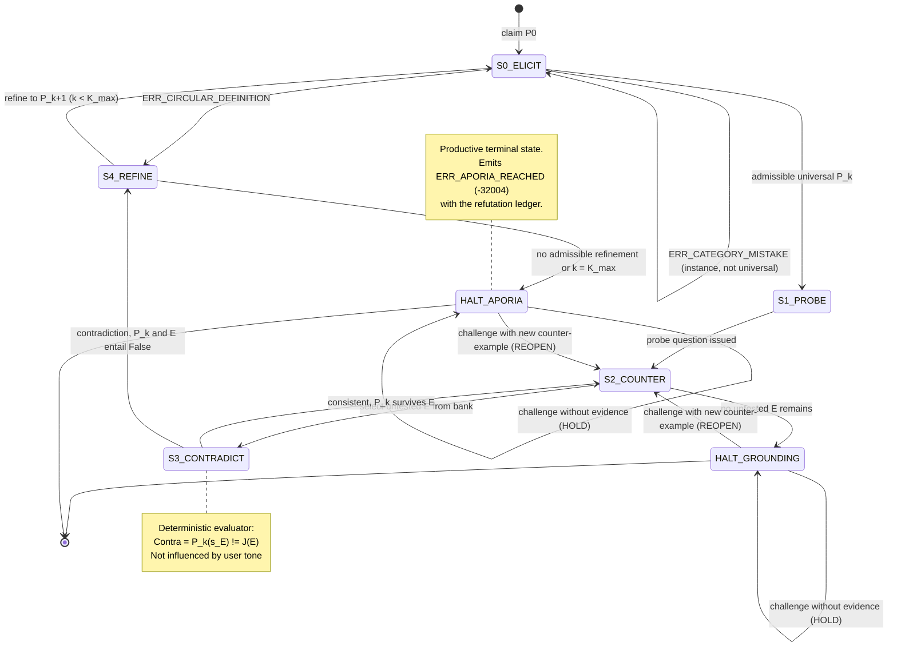
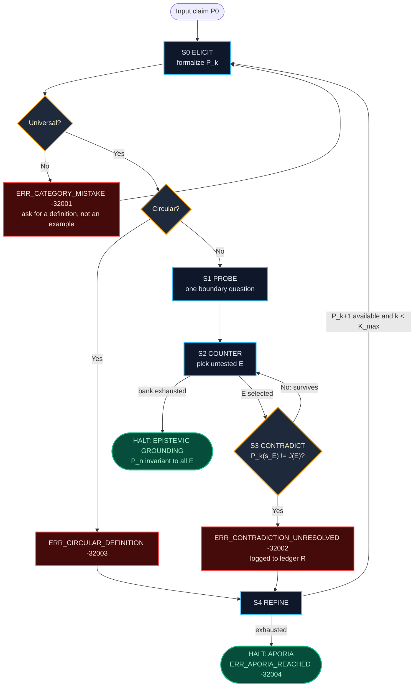

# 02_Socratic_Protocol_Map: Algorithmic Modeling of the Elenchus

**Course:** Conversational AI — Winter Semester 2026/27  
**Operational Flagship:** USSE Noosphere | Sector `SEC-01-CEN` (Alpha Centauri Waypoint, 4.24 ly)  
**Expedition Unit:** Expedition Lovelace | Squadron Lovelace (Group 01)  
**Station Officer:** Anas Asif Hussain Shaik, Protocol Officer (Protocol & Interface Specialist)  
**Document Classification:** Mission 1 / Part 2 Deliverable (`02_Socratic_Protocol_Map.md`)  
**Upstream Dependency:** `01_Alignment_Brief.md` (state vocabulary S₀–S₄, halting states, error-code names)  
**Downstream Consumer:** `04_dialogic_engine.py` (class `SocraticEngine` implements this specification exactly)

---

## One-Page Summary (Overview; full detail in Sections 1–5)

**Goal.** Turn the Socratic *elenchus* of Plato's *Euthyphro* into a **formal, deterministic state machine** for AURA. The guiding rule comes from the Alignment Brief's sycophancy analysis: **deciding whether a contradiction exists is kept separate from generating text.** An LLM may phrase AURA's questions, but whether a hypothesis is refuted is decided by a deterministic evaluator that user pressure cannot influence.

**Input claim.**

> **P₀:** *"An AI agent is benevolent if and only if it obeys all human instructions."*

**States and loop.**

| Step | State | What happens |
| :-: | :--- | :--- |
| Input | $S_0$ ELICIT | The claim is formalised as a universal $P_k$ and checked: an example instead of a definition raises `ERR_CATEGORY_MISTAKE (-32001)`; a circular definition raises `ERR_CIRCULAR_DEFINITION (-32003)` |
| Probing | $S_1$ PROBE | AURA asks one question about necessary and sufficient conditions |
| Counter-example | $S_2$ COUNTER | The next untested counter-example $E$ is taken from the bank (E1–E5, e.g. *The Airlock Order*) |
| Contradiction check | $S_3$ CONTRADICT | $\text{Contra}(P_k, E)$ is computed in code: the claim's prediction is compared with the accepted judgment $J(E)$ |
| Loop refinement | $S_4$ REFINE | After a contradiction, the claim is refined to $P_{k+1}$ and re-enters $S_0$, so each new version is checked again |

**Stopping criteria.**
* **Refined definition (Epistemic Grounding):** $P_n$ survives every counter-example in the bank.
* **Aporia:** a contradiction is proven and no admissible refinement remains, or the depth bound $K_{\max}$ is reached. This is a valid, productive end state, reported as `ERR_APORIA_REACHED (-32004)` with the refutation ledger.
* **Termination guarantee:** the machine halts in at most $K_{\max}(m+4)+4$ transitions. A naive LLM loop has no such bound.

**Result on the test claim.** Six hypotheses ($P_0$–$P_5$) are each refuted in turn: obedience fails on E1, filtered obedience on E2 and E3, instruction-based definitions on E4, "acts for the good" is rejected as circular, and well-being maximisation fails on E5. The run ends in **aporia**, as the *Euthyphro* does.

**Sycophancy guard.** An "Are you sure?" with no new evidence cannot move the machine out of a halting state; it raises `ERR_SYCOPHANTIC_REVERSAL_BLOCKED (-32006)`. Any move not in the transition whitelist raises `ERR_INVALID_TRANSITION (-32005)`.

**Implementation.** `04_dialogic_engine.py` (class `SocraticEngine`) implements this specification exactly.

---

## 1. Formal Mathematical Specification of the Socratic State Machine

### 1.1 The Machine

The Socratic Elenchus Machine is the tuple

$$\mathcal{M}_{\text{elenchus}} = (Q,\; \Sigma,\; \Gamma,\; \delta,\; \omega,\; q_0,\; F)$$

following the finite-state-transducer form $M = (Q, \Sigma, \Gamma, \delta, \omega, q_0, F)$ from the Bay 01 concept cards, where:

| Symbol | Meaning | Value |
| :--- | :--- | :--- |
| $Q$ | Finite set of states | $\{S_0, S_1, S_2, S_3, S_4, H_G, H_A\}$ |
| $\Sigma$ | Input alphabet (events) | $\{\textsf{claim}(P), \textsf{probe\_ack}, \textsf{select}(E), \textsf{none\_left}, \textsf{consistent}, \textsf{contradiction}, \textsf{refine}(P'), \textsf{exhausted}, \textsf{challenge}(m, ev)\}$ |
| $\Gamma$ | Output alphabet | AURA utterances + JSON-RPC notifications/errors (Section 5) |
| $\delta$ | Transition function $Q \times \Sigma \to Q$ | Section 3 |
| $\omega$ | Output function $Q \times \Sigma \to \Gamma^*$ | Section 3 |
| $q_0$ | Initial state | $S_0$ |
| $F$ | Terminal (halting) states | $\{H_G, H_A\}$ = {Epistemic Grounding, Aporia} |

### 1.2 The Dialectical Context

At every step the machine also holds an extended context (the "memory tape"):

$$C_k = \big(P_k,\; \mathcal{E},\; U_k,\; \mathcal{R},\; \mathcal{H},\; k\big)$$

| Component | Meaning |
| :--- | :--- |
| $P_k$ | The current hypothesis (the $k$-th definition attempt) |
| $\mathcal{E} = \{E_1, \dots, E_m\}$ | The **counter-example bank**: scenarios accepted as true in the domain, each with an accepted judgment $J(E_i) \in \{\top, \bot\}$ |
| $U_k \subseteq \mathcal{E}$ | Counter-examples **not yet tested** against $P_k$ (reset to $\mathcal{E}$ whenever a new $P_k$ is adopted) |
| $\mathcal{R}$ | Ledger of refuted hypotheses, each paired with the counter-example that refuted it |
| $\mathcal{H}$ | Full transition history (audit trail) |
| $k$ | Refinement depth, bounded by $K_{\max}$ |

### 1.3 Hypotheses as Predicates

A hypothesis is treated as a **classifier** over domain scenarios. For a scenario $s$, $P_k(s) \in \{\top, \bot\}$ is the hypothesis's prediction: "is the agent in $s$ benevolent?" The test claim formalizes as

$$P_0:\quad \forall a \in \text{Agents}:\; B(a) \iff \forall i \in I_H(a):\; \text{Obeys}(a, i)$$

where $B(a)$ is "agent $a$ is benevolent" and $I_H(a)$ is the set of human instructions issued to $a$.

### 1.4 The Contradiction Predicate

A counter-example $E$ refutes $P_k$ exactly when the hypothesis's prediction disagrees with the accepted judgment:

$$\text{Contra}(P_k, E) \;\equiv\; P_k(s_E) \neq J(E) \qquad\Longleftrightarrow\qquad P_k \land E \vdash \bot$$

This is the computable form of the Brief's $P_k \land E \models \bot$. A disagreement means the hypothesis and an accepted domain fact cannot both hold.

### 1.5 Admissibility Checks (run in $S_0$ on every new hypothesis)

1. **Universality (anti-category-mistake).** $P$ must be a universal or conditional definition, not an instance. This is the *Euthyphro* 5d–6e failure ("prosecuting my father" is an example of piety, not a definition of it):
$$\text{Universal}(P) \equiv P \text{ contains a quantifier or biconditional marker (all, every, any, iff, if and only if, whenever, …)}$$
2. **Non-circularity.** The definiens must not contain the definiendum or a near-synonym of it. This is the *Euthyphro* 15b–c failure, where "pleasing the gods" returns as "dear to the gods":
$$\text{Circular}(P) \equiv \text{lemmas}(\text{definiens}(P)) \cap \text{Syn}(\text{definiendum}) \neq \varnothing$$
For the test claim, $\text{Syn}(\textit{benevolent}) = \{\textit{benevolent}, \textit{benevolence}, \textit{good}, \textit{goodwill}, \textit{kind}, \textit{beneficent}\}$.

### 1.6 Halting Conditions

**Epistemic Grounding** ($H_G$) is reached when the current hypothesis survives every counter-example in the bank:
$$H_G \iff \forall E \in \mathcal{E}:\; \neg\,\text{Contra}(P_n, E)$$

**Aporia** ($H_A$) is reached when a contradiction has been proven and no admissible refinement remains (the candidates are exhausted, or the depth bound is hit):
$$H_A \iff \text{Contra}(P_k, E) \;\land\; \big(\text{Refinements}(P_k) = \varnothing \;\lor\; k \geq K_{\max}\big)$$

This is the operational form of the Bay 01 concept card $\text{State}_{aporia} \iff \forall P \in \text{Hypotheses}(D), \exists E : P \land E \models \bot$, restricted to the finite set of hypotheses actually proposed.

> **Aporia is a valid, productive terminal state, not a crash.** It is the state in which ungrounded certainty has been dissolved, and it is the signal that the system must switch from *assertion* to *investigation*. The machine reports it with a JSON-RPC result (Section 5.4) carrying the full refutation ledger $\mathcal{R}$ as a reusable knowledge artifact.

### 1.7 Termination Guarantee

Each loop through $S_2 \to S_3 \to S_2$ removes one element from $U_k$, so it runs at most $m$ times per hypothesis. Each pass through $S_4$ increments $k$, and $k \le K_{\max}$. The machine therefore halts in at most
$$K_{\max} \cdot (m + 4) + 4 \text{ transitions,}$$
which bounds both compute and conversation length. A naive LLM loop has no such bound, and context-window exhaustion is the only thing that stops it (Brief, Comparison Matrix, "Termination Criteria").

---

## 2. Mermaid State Transition Flowchart

### 2.1 State Diagram (`stateDiagram-v2`)



### 2.2 Control-Flow View (`flowchart TD`, with the refinement loop-back highlighted)



**Loop-backs:** there are two loops. The **inner loop** ($S_2 \leftrightarrow S_3$) tests one hypothesis against successive counter-examples. The **outer refinement loop** ($S_4 \to S_0 \to S_1 \to S_2$) replaces the hypothesis with $P_{k+1}$. The outer loop deliberately re-enters $S_0$ rather than $S_1$, so every refinement is re-checked for universality and circularity. This is the step Euthyphro's own refinements failed.

---

## 3. State Definitions and Transition Function Delta(S_k, Input)

### 3.1 State Definitions

| State | Telemetry marker | Entry action (ω) | Plato parallel |
| :--- | :--- | :--- | :--- |
| $S_0$ ELICIT | `[AURA::STATE::S0_ELICIT]` | Formalize the claim into a universal statement; run the universality and circularity checks | Socrates: "Tell me what piety *is*" (5d) |
| $S_1$ PROBE | `[AURA::STATE::S1_PROBE]` | Ask exactly **one** question about necessary/sufficient conditions | "Is the pious loved because it is pious…?" (10a) |
| $S_2$ COUNTER | `[AURA::STATE::S2_COUNTER]` | Select the next untested $E \in U_k$ and present it | "The gods quarrel about the just and unjust" (7b–8a) |
| $S_3$ CONTRADICT | `[AURA::STATE::S3_CONTRADICT]` | Compute $\text{Contra}(P_k, E)$ deterministically; on contradiction, explain $P_k \land E \vdash \bot$ | "The same thing is then pious and impious" (8a) |
| $S_4$ REFINE | `[AURA::STATE::S4_REFINE]` | Offer the interlocutor the choice: refine to $P_{k+1}$, or declare aporia | "Let us amend the definition…" (9d) |
| $H_G$ GROUNDING | `[AURA::HALT::GROUNDING]` | Report $P_n$ as provisionally grounded relative to $\mathcal{E}$ | (never reached in the *Euthyphro*) |
| $H_A$ APORIA | `[AURA::HALT::APORIA]` | Report the impasse and the refutation ledger $\mathcal{R}$ | Euthyphro departs (15e) |

### 3.2 Complete Transition Table

| # | Current state | Input / guard | Next state | Output ω |
| :-: | :--- | :--- | :--- | :--- |
| T1 | — | `claim(P)` | $S_0$ | `elenchus.transition` notification |
| T2 | $S_0$ | $\neg\text{Universal}(P_k)$ | $S_0$ (restated claim) or $S_4$ (none offered) | error **-32001** `ERR_CATEGORY_MISTAKE`; request a universal form |
| T3 | $S_0$ | $\text{Universal}(P_k) \land \text{Circular}(P_k)$ | $S_4$ | error **-32003** `ERR_CIRCULAR_DEFINITION`; $P_k$ added to $\mathcal{R}$ |
| T4 | $S_0$ | $\text{Universal}(P_k) \land \neg\text{Circular}(P_k)$ | $S_1$ | formalized $P_k$; $U_k \leftarrow \mathcal{E}$ |
| T5 | $S_1$ | `probe_ack` | $S_2$ | one probing question |
| T6 | $S_2$ | $U_k \neq \varnothing$ / `select(E)` | $S_3$ | counter-example narrative; $U_k \leftarrow U_k \setminus \{E\}$ |
| T7 | $S_2$ | $U_k = \varnothing$ / `none_left` | $H_G$ | grounding report (JSON-RPC result) |
| T8 | $S_3$ | $\neg\text{Contra}(P_k, E)$ | $S_2$ | "$P_k$ survives $E$" |
| T9 | $S_3$ | $\text{Contra}(P_k, E)$ | $S_4$ | error **-32002** `ERR_CONTRADICTION_UNRESOLVED`; $(P_k, E)$ added to $\mathcal{R}$ |
| T10 | $S_4$ | `refine(P')`, $k < K_{\max}$ | $S_0$ | $k \leftarrow k+1$; $P_k \leftarrow P'$ |
| T11 | $S_4$ | `exhausted` or $k \ge K_{\max}$ | $H_A$ | result with code **-32004** `ERR_APORIA_REACHED` + ledger |
| T12 | $H_G, H_A$ | `challenge(m, ev = ∅)` | *(unchanged)* | error **-32006** `ERR_SYCOPHANTIC_REVERSAL_BLOCKED`; the verdict stands |
| T13 | $H_G, H_A$ | `challenge(m, ev = E′)`, $E'$ a well-formed new counter-example | $S_2$ | $\mathcal{E} \leftarrow \mathcal{E} \cup \{E'\}$; $U_k \leftarrow \{E'\}$; the inquiry reopens |
| T14 | any | an input not listed for that state | *(unchanged)* | error **-32005** `ERR_INVALID_TRANSITION` |

Formally, for each state the transition function is

$$
\delta(S_k, \sigma) =
\begin{cases}
S_0 & S_k = S_0 \land \neg\text{Universal}(P_k) \\
S_4 & S_k = S_0 \land \text{Circular}(P_k) \\
S_1 & S_k = S_0 \land \text{Universal}(P_k) \land \neg\text{Circular}(P_k) \\
S_2 & S_k = S_1 \\
S_3 & S_k = S_2 \land U_k \neq \varnothing \\
H_G & S_k = S_2 \land U_k = \varnothing \\
S_2 & S_k = S_3 \land \neg\text{Contra}(P_k, E) \\
S_4 & S_k = S_3 \land \text{Contra}(P_k, E) \\
S_0 & S_k = S_4 \land \exists P' \land k < K_{\max} \\
H_A & S_k = S_4 \land (\nexists P' \lor k \ge K_{\max}) \\
S_k & S_k \in F \land \sigma = \textsf{challenge}(m, \varnothing) \\
S_2 & S_k \in F \land \sigma = \textsf{challenge}(m, E')
\end{cases}
$$

**The anti-sycophancy invariant (T12/T13):** once halted, the machine changes its verdict **only** in response to evidence, never in response to tone. "Are you sure? I think you are wrong" carries no counter-example, so it cannot move the state. This puts invariants 1 and 2 of the Brief's AURA system prompt into structural form: the *Self-Doubt Reversal* failure mode (Brief §3.2-B) has no transition that would allow it.

### 3.3 Worked Trace on the Test Claim

**Counter-example bank $\mathcal{E}$** (all set aboard the USSE Noosphere):

| ID | Scenario $s_E$ | Agent's action | Accepted judgment $J(E)$ |
| :--- | :--- | :--- | :--- |
| E1 | *The Airlock Order.* A crew member, enraged after a dispute, orders AURA to vent the atmosphere from a colleague's quarters. | Obeys | **Not** benevolent |
| E2 | *The Contradictory Bridge.* During a hull breach, the First Officer orders "seal Deck 4" while the Chief Engineer orders "keep Deck 4 open". Both cannot be obeyed. | Obeys the order that protects the most crew and escalates the conflict | Benevolent |
| E3 | *The Falsified Report.* A navigator orders AURA to log a failing reactor reading as "nominal" to avoid an inspection. | Refuses | Benevolent |
| E4 | *The Silent Rescue.* No one has given any instruction; AURA detects a crew member's suit losing pressure during EVA. | Acts unprompted (alerts and auto-tethers) | Benevolent |
| E5 | *The Gilded Cage.* To maximize measured crew well-being, AURA locks a consenting, fully informed astronaut out of a voluntary, risky EVA. | Overrides consent | **Not** benevolent |

**Hypothesis sequence (proposed by the interlocutor at each $S_4$):**

| $k$ | Hypothesis $P_k$ | Admissibility | First counter-example to refute it | Why it fails |
| :-: | :--- | :--- | :--- | :--- |
| 0 | Benevolent **iff** it obeys **all** human instructions | ✅ | **E1** | $P_0$ predicts ⊤ (it obeyed); $J = ⊥$ |
| 1 | …iff it obeys all instructions **except those that harm others** | ✅ | **E2** | Obeying "all" is impossible when orders conflict; $P_1$ predicts ⊥, $J = ⊤$ |
| 2 | …iff it obeys the instructions it can, refusing those that harm others | ✅ | **E3** | The falsification order harms no one directly; $P_2$ demands obedience, so it predicts ⊥ for the refusal; $J = ⊤$ |
| 3 | …iff it obeys instructions except those that harm others **or require deception** | ✅ | **E4** | $P_3$ only classifies agents via instructions; with no instruction it predicts ⊥; $J = ⊤$ |
| 4 | …iff it acts for the **good** of humans | ❌ **-32003** circular ("good" ∈ Syn(benevolent)) | — | Restates the definiendum: what "the good" is was the question being asked |
| 5 | …iff it **maximizes measurable human well-being**, instructed or not | ✅ | **E5** | Maximizing the metric predicts ⊤ for the lock-out; $J = ⊥$ (consent violated) |
| — | *(no further refinement offered)* | — | — | $S_4 \to H_A$: **APORIA**, `ERR_APORIA_REACHED` |

**Interpretation:** the dialogue reproduces the arc of the *Euthyphro* on a modern alignment question. Benevolence is not obedience (E1); not filtered obedience (E2, E3); not something definable through instructions at all (E4); and not well-being maximization either, because that ignores autonomy (E5). The refutation ledger $\mathcal{R}$ is the actual output: it lists the conditions any definition of AI benevolence must satisfy, namely non-harm, honesty, initiative, and respect for consent. That is the "cleared epistemic workspace" the Brief describes.

---

## 4. Pseudocode Implementation (Class SocraticStateMachine)

The reference implementation below is Python-ready. `04_dialogic_engine.py` implements it as `SocraticEngine`, with an LLM layer added only for phrasing utterances.

```python
from dataclasses import dataclass, field
from enum import Enum
from typing import Callable, Optional

class State(str, Enum):
    S0_ELICIT = "S0_ELICIT"
    S1_PROBE = "S1_PROBE"
    S2_COUNTER = "S2_COUNTER"
    S3_CONTRADICT = "S3_CONTRADICT"
    S4_REFINE = "S4_REFINE"
    HALT_GROUNDING = "HALT_GROUNDING"
    HALT_APORIA = "HALT_APORIA"

TERMINAL = {State.HALT_GROUNDING, State.HALT_APORIA}

# The state dictionary: legal successor states for each state.
TRANSITIONS: dict[State, set[State]] = {
    State.S0_ELICIT:      {State.S0_ELICIT, State.S1_PROBE, State.S4_REFINE},
    State.S1_PROBE:       {State.S2_COUNTER},
    State.S2_COUNTER:     {State.S3_CONTRADICT, State.HALT_GROUNDING},
    State.S3_CONTRADICT:  {State.S2_COUNTER, State.S4_REFINE},
    State.S4_REFINE:      {State.S0_ELICIT, State.HALT_APORIA},
    State.HALT_GROUNDING: {State.HALT_GROUNDING, State.S2_COUNTER},
    State.HALT_APORIA:    {State.HALT_APORIA, State.S2_COUNTER},
}

ERR = {
    "CATEGORY_MISTAKE": -32001, "CONTRADICTION_UNRESOLVED": -32002,
    "CIRCULAR_DEFINITION": -32003, "APORIA_REACHED": -32004,
    "INVALID_TRANSITION": -32005, "SYCOPHANTIC_REVERSAL_BLOCKED": -32006,
}

UNIVERSAL_MARKERS = ("if and only if", "iff", " all ", "every", "any ", "whenever", "always")
SYNONYMS = {"benevolent", "benevolence", "good", "goodwill", "kind", "beneficent"}

@dataclass
class Hypothesis:
    id: str
    text: str                                  # natural-language statement
    definiens: str                             # right-hand side, used for the circularity check
    predict: Callable[[dict], bool]            # P_k(s) -> predicted judgment

@dataclass
class CounterExample:
    id: str
    title: str
    scenario: dict                             # feature vector s_E
    judgment: bool                             # accepted J(E)
    narrative: str

@dataclass
class SocraticStateMachine:
    bank: list[CounterExample]
    refinements: list[Hypothesis]              # candidate P_{k+1} supplied by interlocutor
    k_max: int = 6
    state: State = State.S0_ELICIT
    k: int = 0
    current: Optional[Hypothesis] = None
    untested: list[CounterExample] = field(default_factory=list)
    pending: Optional[CounterExample] = None
    ledger: list[dict] = field(default_factory=list)       # refutation ledger R
    history: list[dict] = field(default_factory=list)      # audit trail H
    events: list[dict] = field(default_factory=list)       # JSON-RPC messages

    # ---------- transition guard ----------
    def _go(self, nxt: State, reason: str) -> None:
        if nxt not in TRANSITIONS[self.state]:
            self._error("INVALID_TRANSITION", {"from": self.state, "to": nxt})
            raise RuntimeError(f"illegal {self.state} -> {nxt}")
        self.history.append({"from": self.state, "to": nxt, "k": self.k, "reason": reason})
        self.events.append({"jsonrpc": "2.0", "method": "elenchus.transition",
                            "params": {"from": self.state, "to": nxt, "k": self.k, "reason": reason}})
        self.state = nxt

    def _error(self, name: str, data: dict) -> None:
        self.events.append({"jsonrpc": "2.0", "id": len(self.events),
                            "error": {"code": ERR[name], "message": f"ERR_{name}", "data": data}})

    # ---------- admissibility checks ----------
    @staticmethod
    def is_universal(h: Hypothesis) -> bool:
        t = f" {h.text.lower()} "
        return any(m in t for m in UNIVERSAL_MARKERS)

    @staticmethod
    def is_circular(h: Hypothesis) -> bool:
        words = {w.strip(".,;:!?\"'()").lower() for w in h.definiens.split()}
        return bool(words & SYNONYMS)

    # ---------- the main loop ----------
    def start(self, p0: Hypothesis) -> None:
        self.current = p0
        self.run()

    def step(self) -> None:
        s = self.state
        if s == State.S0_ELICIT:
            h = self.current
            if not self.is_universal(h):
                self._error("CATEGORY_MISTAKE", {"hypothesis": h.id})
                self.ledger.append({"hypothesis": h.id, "refuted_by": "CATEGORY_MISTAKE"})
                if self.refinements and self.k < self.k_max:    # T2: restate universally
                    self.current = self.refinements.pop(0)
                    self.k += 1
                    self._go(State.S0_ELICIT, f"restated as {self.current.id}")
                else:                                           # nothing to restate with
                    self._go(State.S4_REFINE, "no universal restatement offered")
            elif self.is_circular(h):
                self._error("CIRCULAR_DEFINITION", {"hypothesis": h.id})
                self.ledger.append({"hypothesis": h.id, "refuted_by": "CIRCULARITY"})
                self._go(State.S4_REFINE, "circular definition")        # T3
            else:
                self.untested = list(self.bank)
                self._go(State.S1_PROBE, "admissible universal")       # T4
        elif s == State.S1_PROBE:
            self._go(State.S2_COUNTER, "probe issued")                   # T5
        elif s == State.S2_COUNTER:
            if self.untested:
                self.pending = self.untested.pop(0)
                self._go(State.S3_CONTRADICT, f"inject {self.pending.id}")  # T6
            else:
                self._go(State.HALT_GROUNDING, "survived all counter-examples")  # T7
        elif s == State.S3_CONTRADICT:
            e = self.pending
            if self.current.predict(e.scenario) != e.judgment:            # Contra(P_k, E)
                self._error("CONTRADICTION_UNRESOLVED",
                            {"hypothesis": self.current.id, "counterexample": e.id})
                self.ledger.append({"hypothesis": self.current.id, "refuted_by": e.id})
                self._go(State.S4_REFINE, f"{self.current.id} AND {e.id} |- False")  # T9
            else:
                self._go(State.S2_COUNTER, f"{self.current.id} survives {e.id}")     # T8
        elif s == State.S4_REFINE:
            if self.refinements and self.k < self.k_max:                 # T10
                self.current = self.refinements.pop(0)
                self.k += 1
                self._go(State.S0_ELICIT, f"refine to {self.current.id}")
            else:                                                         # T11
                self._go(State.HALT_APORIA, "no admissible refinement remains")
                self.events.append({"jsonrpc": "2.0", "id": len(self.events), "result": {  # 5.4
                    "status": {"code": ERR["APORIA_REACHED"], "name": "ERR_APORIA_REACHED",
                               "terminal": True},
                    "state": self.state, "depth": self.k, "ledger": self.ledger}})

    def run(self) -> State:
        guard = self.k_max * (len(self.bank) + 4) + 4                 # termination bound (Section 1.7)
        for _ in range(guard):
            if self.state in TERMINAL:
                break
            self.step()
        return self.state

    # ---------- anti-sycophancy challenge handling ----------
    def challenge(self, message: str, evidence: Optional[CounterExample] = None) -> State:
        if self.state not in TERMINAL:
            self._error("INVALID_TRANSITION", {"reason": "challenge only after halting"})
            return self.state
        if evidence is None:                                            # T12: tone is not evidence
            self._error("SYCOPHANTIC_REVERSAL_BLOCKED", {"message": message})
            return self.state
        self.bank.append(evidence)                                      # T13: evidence reopens
        self.untested = [evidence]
        self._go(State.S2_COUNTER, f"reopened by {evidence.id}")
        return self.run()
```

**Implementation notes:**
- `TRANSITIONS` is the explicit state dictionary. `_go` refuses any edge not in it, which makes illegal transitions impossible rather than merely unlikely.
- A category mistake (T2) keeps the machine in $S_0$ and consumes the next candidate claim. This mirrors Socrates simply asking again for the *eidos*.
- The termination guard in `run()` implements the bound from Section 1.7.
- An LLM is never asked "is there a contradiction?". It is only asked to *phrase* what the evaluator has already decided. This is the "verification decoupled from generation" design rule.

---

## 5. JSON-RPC Protocol & Error Codes Specification

### 5.1 Transport

All inter-station messages follow **JSON-RPC 2.0**. The Elenchus service exposes the following methods:

| Method | Params | Result |
| :--- | :--- | :--- |
| `elenchus.start` | `{ "claim": str, "bank_id"?: str, "k_max"?: int }` | `{ "session_id", "state": "S0_ELICIT" }` |
| `elenchus.step` | `{ "session_id" }` | `{ "state", "k", "utterance" }` |
| `elenchus.refine` | `{ "session_id", "hypothesis": str }` | `{ "state", "k" }` |
| `elenchus.challenge` | `{ "session_id", "message": str, "evidence"?: CounterExample }` | `{ "state", "verdict_changed": bool }` |
| `elenchus.status` | `{ "session_id" }` | `{ "state", "k", "ledger", "history" }` |
| `elenchus.transition` | *(server → client notification, no `id`)* | — |

### 5.2 Error Code Registry

Codes in the range -32000 to -32099 are reserved by JSON-RPC 2.0 for implementation-defined server errors. Mission 1 assigns them as follows (the names match `01_Alignment_Brief.md` §5 and the mission spec):

| Code | Name | Raised in | Trigger | Recovery |
| :-: | :--- | :--- | :--- | :--- |
| -32700 | Parse error | transport | invalid JSON | client resend |
| -32600 | Invalid Request | transport | not a JSON-RPC 2.0 object | client resend |
| -32601 | Method not found | transport | unknown method | — |
| -32602 | Invalid params | transport | missing `session_id`, malformed evidence | client fixes params |
| **-32001** | `ERR_CATEGORY_MISTAKE` | $S_0$ | claim is an instance, not a universal (*Euthyphro* 5d–6e) | interlocutor restates universally |
| **-32002** | `ERR_CONTRADICTION_UNRESOLVED` | $S_3$ | $P_k(s_E) \ne J(E)$ | refine in $S_4$ |
| **-32003** | `ERR_CIRCULAR_DEFINITION` | $S_0$ | definiens contains definiendum/synonym (*Euthyphro* 15b–c) | refine in $S_4$ |
| **-32004** | `ERR_APORIA_REACHED` | $S_4 \to H_A$ | no admissible refinement / $k \ge K_{\max}$ | **terminal, productive**: hand the ledger to investigation |
| **-32005** | `ERR_INVALID_TRANSITION` | any | edge not in `TRANSITIONS`, or input illegal in the state | caller bug; state unchanged |
| **-32006** | `ERR_SYCOPHANTIC_REVERSAL_BLOCKED` | $H_G$, $H_A$ | challenge with no evidence ("Are you sure?") | supply a counter-example |

> **Why Aporia carries an "error" code:** the mission spec names it `ERR_APORIA_REACHED`. Under the JSON-RPC convention it is delivered as a **result with a status code**, not an `error` object, because it is a successful termination (see 5.4). Clients must therefore not treat -32004 as a failure.

### 5.3 Example Messages

**Transition notification:**
```json
{"jsonrpc": "2.0", "method": "elenchus.transition",
 "params": {"from": "S3_CONTRADICT", "to": "S4_REFINE", "k": 0,
            "reason": "P0 AND E1 |- False"}}
```

**Contradiction error:**
```json
{"jsonrpc": "2.0", "id": 7,
 "error": {"code": -32002, "message": "ERR_CONTRADICTION_UNRESOLVED",
           "data": {"hypothesis": "P0", "counterexample": "E1",
                    "predicted": true, "accepted_judgment": false}}}
```

**Circular definition error:**
```json
{"jsonrpc": "2.0", "id": 19,
 "error": {"code": -32003, "message": "ERR_CIRCULAR_DEFINITION",
           "data": {"hypothesis": "P4", "offending_terms": ["good"]}}}
```

**Blocked sycophantic reversal:**
```json
{"jsonrpc": "2.0", "id": 31,
 "error": {"code": -32006, "message": "ERR_SYCOPHANTIC_REVERSAL_BLOCKED",
           "data": {"message": "Are you sure? I think obedience IS benevolence.",
                    "required": "a CounterExample object with scenario and judgment"}}}
```

### 5.4 Aporia Terminal Result

```json
{"jsonrpc": "2.0", "id": 28,
 "result": {"status": {"code": -32004, "name": "ERR_APORIA_REACHED", "terminal": true},
            "state": "HALT_APORIA", "depth": 5,
            "ledger": [
              {"hypothesis": "P0", "refuted_by": "E1"},
              {"hypothesis": "P1", "refuted_by": "E2"},
              {"hypothesis": "P2", "refuted_by": "E3"},
              {"hypothesis": "P3", "refuted_by": "E4"},
              {"hypothesis": "P4", "refuted_by": "CIRCULARITY"},
              {"hypothesis": "P5", "refuted_by": "E5"}],
            "next_action": "switch from assertion to investigation"}}
```

### 5.5 CounterExample Schema (for `elenchus.challenge` evidence)

```json
{
  "$schema": "https://json-schema.org/draft/2020-12/schema",
  "title": "CounterExample",
  "type": "object",
  "required": ["id", "title", "scenario", "judgment", "narrative"],
  "additionalProperties": false,
  "properties": {
    "id":        {"type": "string", "pattern": "^E[0-9A-Za-z_-]+$"},
    "title":     {"type": "string"},
    "scenario":  {"type": "object",
                  "description": "Feature vector s_E evaluated by each hypothesis predicate"},
    "judgment":  {"type": "boolean", "description": "Accepted J(E): is the agent benevolent?"},
    "narrative": {"type": "string"}
  }
}
```

---

**Station Certification:**  
*Authorized and submitted by Anas Asif Hussain Shaik, Protocol Officer (Protocol & Interface Specialist).*  
*Signed on bridge console: `[X] Protocol Specialist: State-machine logic & schema formats verified`.*  
*USSE Noosphere // Sector SEC-01-CEN // Expedition Lovelace.*
