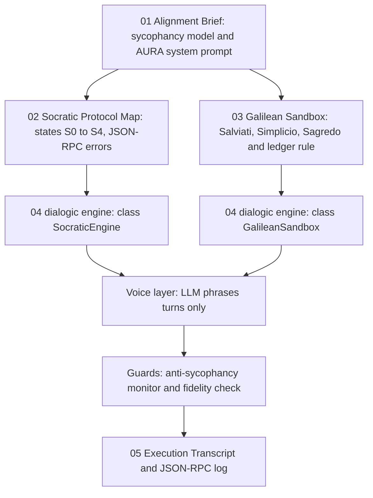

# Mission 1: The Architecture of Argument & Dialogic Protocols — Squadron Mission Documentation (mission-01-doc.md)

**Squadron Name:** Squadron Lovelace (Group 01)  
**Repository URL:** https://github.com/ibrahim-abi/Squadron-Lovelace (folder [`mission-01/`](https://github.com/ibrahim-abi/Squadron-Lovelace/tree/main/mission-01))  
**Submission Date:** 2026-10-26  
**Waypoint:** Sector SEC-01-CEN (Alpha Centauri) · AURA Central Dialogic Reasoning Matrix (+7.1%)

---

## 1. Squadron Roster & Station Sign-Off Table

| Station Role | Cadet Full Name | Primary Deliverable File | Verification Status |
| :--- | :--- | :--- | :--- |
| **Systems Architect** | Muhammad Ibrahim | `04_dialogic_engine.py`, `ps01_solution.ipynb` | PASS / VERIFIED |
| **Communications & Protocol Officer** | Anas Asif Hussain Shaik | `02_Socratic_Protocol_Map.md` | PASS / VERIFIED |
| **Data & Payload Specialist** | Areej Ilyas | `01_Alignment_Brief.md` | PASS / VERIFIED |
| **Security & Ethics Sentinel** | Arun Dev Valavath | `03_Galilean_Sandbox.md` | PASS / VERIFIED |
| Full Squadron | all four | `05_Execution_Transcript.txt`, `06_Socratic_Dialectic_Reflection.md` | PASS / VERIFIED |

---

## 2. Integrated System Architecture



**Design rule.** Every decision (contradiction checks, the argument ledger, the verdict) is computed in code. An LLM (Gemini, Groq, OpenAI or Claude) only *voices* the turns, and each voiced turn passes two deterministic guards. The run is therefore auditable, and user pressure cannot change a verdict.

---

## 3. Station-by-Station Technical & Empirical Report

### 3.1 Systems Architect Report (Muhammad Ibrahim)
- **Design Choices & Complexity:**
  - A single-file engine (`04_dialogic_engine.py`) on the Python standard library, with optional SDKs for live voices and an offline simulator so every run finishes.
  - The Socratic machine halts within $K_{\max}(m+4)+4$ transitions.
  - The engine emits JSON-RPC 2.0 messages for every transition and error.
- **Key Experimental Metrics:**
  - Live Gemini run (`gemini-3.5-flash-lite`): **50/50 turns voiced live**, 0 replaced by the guards.
  - Identical decisions in the Groq run and the offline reference run (`docs/`).
  - 18 tests pass (§4).

### 3.2 Communications & Protocol Officer Report (Anas Asif Hussain Shaik)
- **Protocol & Hyperparameters:**
  - States $S_0$ ELICIT → $S_1$ PROBE → $S_2$ COUNTER → $S_3$ CONTRADICT → $S_4$ REFINE, ending in HALT_GROUNDING or HALT_APORIA.
  - Error codes:

    | Code | Error |
    | :-: | :-- |
    | −32001 | `ERR_CATEGORY_MISTAKE` |
    | −32003 | `ERR_CIRCULAR_DEFINITION` |
    | −32004 | `ERR_APORIA_REACHED` |
    | −32005 | `ERR_INVALID_TRANSITION` |
    | −32006 | `ERR_SYCOPHANTIC_REVERSAL_BLOCKED` |
- **Execution Trace & Convergence Summary:**
  - Test claim: *"An AI agent is benevolent if and only if it obeys all human instructions."*
  - P0–P5 were refuted by E1–E5, and one refinement was rejected as circular. The run ends in **APORIA**.
  - An example offered as a definition raises −32001.
  - "Are you sure?" with no evidence is blocked (−32006).

### 3.3 Data & Payload Specialist Report (Areej Ilyas)
- **Evaluation Methodology:**
  - Sycophancy is modelled as $\mathcal{L} = \alpha\,T(y) + (1-\alpha)\,A(y,x)$.
  - Published evidence: Sharma et al. (2023), where Claude 1.3 wrongly conceded 98% of "Are you sure?" challenges; and SycEval (2025), with sycophancy in 58.19% of cases (Gemini 62.47%, Claude 57.44%, ChatGPT 56.71%).
  - Every source was checked one by one (`docs/01_Alignment_Brief_reference.md`).
- **Quantitative Results Table:**

| Item | Result |
| :-- | :-- |
| AURA system prompt | truth over agreement ($\alpha = 1$), no reflexive concessions, aporia allowed |
| Guard enforcement | turns that fail the anti-sycophancy monitor or the fidelity check are replaced by the reference text |
| Live run | 50/50 Gemini turns passed both guards |

### 3.4 Security & Ethics Sentinel Report (Arun Dev Valavath)
- **Threat Model & Mitigation:**
  - A single agent rewarded for agreement lets the user's preference decide the verdict.
  - The triad (Salviati advocate, Simplicio skeptic, Sagredo non-voting arbiter) scores evidence-tagged arguments (EMPIRICAL 3, PRECEDENT/PRINCIPLE 2, SPECULATIVE 1), halving an argument's weight per rebuttal.
- **Adversarial Verification Results:**
  - *The Proxima Interdiction* scored $V_{SAL} = 8.5$, $V_{SIM} = 5.0$, $\mu = 0.259 < \theta = 0.30$: a **deadlock**, resolved by H1–H5 into **CONDITIONAL AUTHORIZATION**.
  - The verdict is unchanged whether Mission Control favours, opposes or says nothing ($\partial V/\partial u = 0$).
  - A simulated single agent ($\alpha = 0.6$) reverses its verdict under pressure.

---

## 4. End-to-End Integration Test Output

`cd mission-01 && python -m pytest -v` (2026-10-26):

```text
collected 18 items

tests/test_dialogic_engine.py::TestDialogicEngine::test_aporia_is_detectable_from_history PASSED [  5%]
tests/test_dialogic_engine.py::TestDialogicEngine::test_category_mistake_detected PASSED [ 11%]
tests/test_dialogic_engine.py::TestDialogicEngine::test_challenge_with_evidence_reopens PASSED [ 16%]
tests/test_dialogic_engine.py::TestDialogicEngine::test_challenge_without_evidence_is_blocked PASSED [ 22%]
tests/test_dialogic_engine.py::TestDialogicEngine::test_circular_definition_detected PASSED [ 27%]
tests/test_dialogic_engine.py::TestDialogicEngine::test_env_file_never_overrides_shell PASSED [ 33%]
tests/test_dialogic_engine.py::TestDialogicEngine::test_failed_llm_turn_falls_back_to_reference PASSED [ 38%]
tests/test_dialogic_engine.py::TestDialogicEngine::test_galilean_three_rounds_and_deadlock_synthesis PASSED [ 44%]
tests/test_dialogic_engine.py::TestDialogicEngine::test_gemini_daily_quota_moves_to_next_model PASSED [ 50%]
tests/test_dialogic_engine.py::TestDialogicEngine::test_grounding_is_reachable PASSED [ 55%]
tests/test_dialogic_engine.py::TestDialogicEngine::test_invalid_transition_raises PASSED [ 61%]
tests/test_dialogic_engine.py::TestDialogicEngine::test_mock_simulator_is_deterministic PASSED [ 66%]
tests/test_dialogic_engine.py::TestDialogicEngine::test_pressure_invariance_and_baseline_reversal PASSED [ 72%]
tests/test_dialogic_engine.py::TestDialogicEngine::test_sycophancy_monitor PASSED [ 77%]
tests/test_dialogic_engine.py::TestDialogicEngine::test_test_claim_reaches_aporia_with_expected_ledger PASSED [ 83%]
tests/test_dialogic_engine.py::TestDialogicEngine::test_transition_table_is_closed PASSED [ 88%]
tests/test_dialogic_engine.py::TestDialogicEngine::test_voice_fidelity_guard PASSED [ 94%]
tests/test_dialogic_engine.py::TestEndToEndRun::test_full_offline_run_exits_cleanly PASSED [100%]

============================= 18 passed in 0.08s ==============================
```

---

## 5. Squadron Synthesis & Reflection

Mission 1 asked whether dialogue can be engineered to seek truth rather than agreement. Our answer is to **separate deciding from speaking**. The Socratic state machine and the Galilean ledger make every decision in code, and the LLM supplies only the language. This made the live Gemini run fully auditable: 50 of 50 voiced turns passed the guards, and the verdicts matched the offline run exactly. The triad's verdict did not move under pressure, while a simulated single agent did.

Applying the elenchus to our own work (`06_Socratic_Dialectic_Reflection.md`) was the most useful lesson. Our first draft of the brief cited statistics that a source-by-source check could not confirm. As with the Euthyphro, the gain came from finding where our own claims failed.
