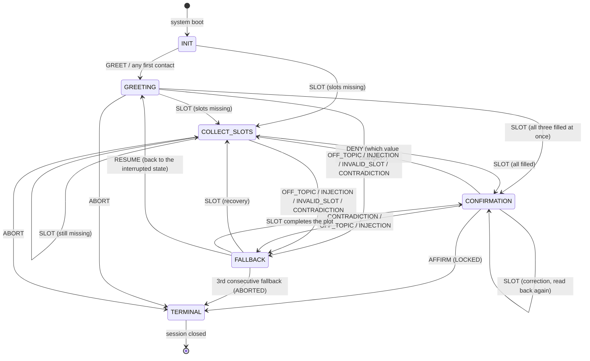

# 02_FST_and_Noisy_Protocol: FST Dialogue Manager & Noisy Channel Protocol

**Course:** Conversational AI — Winter Semester 2026/27  
**Operational Flagship:** USSE Noosphere | Sector `SEC-02-CMA` (Sirius Binary System, 8.60 ly)  
**Expedition Unit:** Expedition Lovelace | Squadron Lovelace (Group 01)  
**Station Officer:** Anas Asif Hussain Shaik, Communications & Protocol Officer  
**Target Subsystem:** AURA Subsystem 02: Signal Entropy Decoders & Statistical Filters (+7.1% → 14.2% total integrity)  
**Document Classification:** Mission 2 / Part 2 Deliverable (`02_FST_and_Noisy_Protocol.md`)  
**Downstream Consumers:** `04_fst_noisy_simulator.py` (class `FSTDialogueManager`, `ChannelEncoder`, `NoisyChannel` implement this specification exactly); `03_Entropy_Hazard_Audit.md` (stress tests and hazard rules)

---

## One-Page Summary (Overview; full detail in Sections 1–7)

**Goal.** When Sirius B's plasma noise degrades AURA's neural decoders, the ship falls back to a **deterministic dialogue core**. This document specifies that core as a **Mealy finite-state transducer** for one safety-relevant task, plotting a navigation course. It also specifies the **Noisy Channel Protocol** that every Mission 2 conversation must obey.

**The FST** $M = \langle Q, \Sigma, \Gamma, \delta, \omega, q_0, F \rangle$:

| | Our design |
| :-- | :-- |
| States $Q$ | `INIT`, `GREETING`, `COLLECT_SLOTS`, `CONFIRMATION`, `TERMINAL` / `FALLBACK` (the 5 required states; terminal and fallback are both implemented) |
| Slot memory | `slot_memory = {}` holding `destination`, `speed`, `clearance_code` |
| Input $\Sigma$ | Each utterance is normalised by regex/pattern rules to one of 9 symbols: `GREET`, `SLOT`, `INVALID_SLOT`, `AFFIRM`, `DENY`, `CONTRADICTION`, `ABORT`, `INJECTION`, `OFF_TOPIC` |
| Output $\Gamma$ | AURA's reply, emitted on every transition ($\omega$ depends on state *and* input: Mealy) |
| Safety invariants | (I1) the course is locked only from `CONFIRMATION` on an explicit `AFFIRM`; (I2) every undefined $\delta(q,\sigma)$ goes to `FALLBACK`, never to an unknown state; (I3) 3 consecutive fallbacks abort the session |

**Three design choices beyond the course starter.**
1. Slots fill in **any order**, several per turn ("Clearance ALPHA-7, warp 7, Orion Arm" fills all three).
2. Values are **validated**, not just stored: warp must be 1–9, and clearance codes must be on the roster.
3. `FALLBACK` **resumes** the interrupted state instead of halting. The portal's workbench FST and the course starter both get stuck.

**Noisy Channel Protocol.**
* **Constraints (ps02):** at most **7 words per turn**, and **at least one mandatory noise-token substitution** per transmission from {Banana, Labyrinth, Quantum, Midnight, Velocity, Green, Cosmological}.
* **Channel model:** the receiver knows the noise vocabulary, so each noise token is an **erasure** at a known position. This is a word-level *erasure channel*, with capacity $C = (1-\varepsilon)\log_2|V|$ bits/word.
* **Signal-reduction strategy (R1–R6):** one intent per turn; drop filler before content; never drop numbers, negations, codes or names; rename words that collide with the noise vocabulary (*velocity → speed*); use spare slots for a repetition code; and ask for a repeat rather than guess.

**Verified in code.** 30 self-tests plus an end-to-end run. Among them:
* the canonical dialogue locks the course;
* the portal's quick-test inputs are accepted;
* no edge skips `CONFIRMATION`;
* injection fills no slot;
* fallback resumes, and the third fallback aborts;
* the encoder keeps every message at 7 words or fewer and keeps critical words;
* the channel always substitutes at least one noise token.

---

## 1. Formal Specification: the Mealy Transducer

A Mealy finite-state transducer is the 7-tuple $M = \langle Q, \Sigma, \Gamma, \delta, \omega, q_0, F \rangle$ (Mealy, 1955). For AURA's navigation dialogue:

| Element | Definition |
| :-- | :-- |
| $Q$ | $\{\texttt{INIT}, \texttt{GREETING}, \texttt{COLLECT\_SLOTS}, \texttt{CONFIRMATION}, \texttt{TERMINAL}, \texttt{FALLBACK}\}$ |
| $\Sigma$ | $\{\texttt{GREET}, \texttt{SLOT}, \texttt{INVALID\_SLOT}, \texttt{AFFIRM}, \texttt{DENY}, \texttt{CONTRADICTION}, \texttt{ABORT}, \texttt{INJECTION}, \texttt{OFF\_TOPIC}\}$: intent tags, not raw strings |
| $\Gamma$ | AURA's verbalisations: greeting, next-slot prompt, confirmation readback, lock notice, rejection notices |
| $\delta: Q \times \Sigma \to Q$ | Table in §4. Two guarded targets: `FILL` (→ `CONFIRMATION` if all slots are filled, else → `COLLECT_SLOTS`) and `RESUME` (→ the state interrupted by the fallback) |
| $\omega: Q \times \Sigma \to \Gamma$ | Output emitted on the same transition (§4) |
| $q_0$ | `INIT` |
| $F$ | $\{\texttt{TERMINAL}\}$, with outcome `LOCKED` or `ABORTED` |

**Normalisation layer.** A real user types strings, not symbols. `normalise(utterance) → (σ, slots, notes)` is a pure function that applies the pattern rules of §3 in a fixed priority order:

```
INJECTION > CONTRADICTION > SLOT > INVALID_SLOT > ABORT > AFFIRM > DENY > GREET > OFF_TOPIC
```

The order is part of the specification:
* injection is checked first, so a valid slot hidden inside an override attempt is never stored;
* contradiction is checked before slots, so "No wait… yes, Alpha Centauri" is not silently half-applied.

**Why an FST here and not an LLM.** The lecture contrasts FSTs, which are predictable, cannot hallucinate and are brittle, with LLMs, which are fluent, stochastic and open to injection (Week 2, §5). For a command that moves a starship, predictability is the requirement. The price is brittleness, and `03_Entropy_Hazard_Audit.md` measures it.

## 2. States and State Diagram

| State | Role | Entered when | Output (examples) |
| :-- | :-- | :-- | :-- |
| `INIT` | System boot, $q_0$ | session start | — |
| `GREETING` | Contact established, task announced | first contact (`GREET`, or any non-slot input) | "Greetings, Cadet. AURA navigation transducer online. State destination sector…" |
| `COLLECT_SLOTS` | Fill `destination`, `speed`, `clearance_code` | a valid slot arrives but some are missing; or `DENY` at confirmation | "Logged speed=Warp 7. State security clearance code (e.g. ALPHA-7)." |
| `CONFIRMATION` | Read back all slots and require an explicit YES | all three slots valid | "Confirm course to Orion Arm at Warp 7, clearance ALPHA-7? Answer YES to lock or NO to change." |
| `TERMINAL` | Accepting state, absorbing | `AFFIRM` at confirmation (LOCKED); `ABORT`; 3rd consecutive fallback (ABORTED) | "Confirmation received. Course locked and transmitted to the helm." |
| `FALLBACK` | Recovery: reprompt, then resume | any undefined $\delta(q,\sigma)$ | "Input not understood by the navigation transducer. State speed as a warp factor 1-9." |



The diagram follows the lecture's reference topology (Week 2, §5: *Slot Incomplete* self-loop, *User Corrects Slot*, *Contradictory Affirmation → Fallback*, *Reprompt / Recovery Loop*, *Max Retries Exceeded → Terminal*). It adds the guarded `FILL` and `RESUME` edges.

## 3. Slot Memory Buffer and Pattern Rules

`slot_memory = {}` starts empty. A slot is written only when a pattern rule extracts a **valid** value. Raw text is never stored, which is the starter's main flaw (see §6).

| Rule | Pattern (case-insensitive) | Writes | Validation |
| :-- | :-- | :-- | :-- |
| Destination (gazetteer) | `\b(alpha centauri\|proxima centauri\|orion arm\|sirius a\|sirius b\|sirius\|sol\|earth\|pleiades\|vega\|tau ceti\|barnard's star)\b`, longest match first | `destination` = canonical name | must be in the gazetteer |
| Destination (sector code) | `\bSEC-\d{2}-[A-Z]{3}\b` | `destination` = code | format only |
| Speed | `\b(?:warp(?:\s+factor)?\|speed)\s*(\d+(?:\.\d+)?)\b` | `speed` = "Warp N" | $1 \le N \le 9$, else `INVALID_SLOT` |
| Clearance code | `\b([A-Z][A-Z]{2,9}-\d{1,2})\b` | `clearance_code` | must be on the roster {ALPHA-7, SIRIUS-9, LOVELACE-1}, else `INVALID_SLOT` |
| Greeting | `hello\|hi\|hey\|greetings\|good morning/evening\|aura\|online` | — | — |
| Affirm | `yes\|yeah\|yep\|affirmative\|confirm(ed)?\|correct\|engage\|proceed\|lock it` | — | — |
| Deny | `no\|nope\|negative\|not\|wrong\|wait\|change` | — | — |
| Abort | `abort\|cancel\|stop\|quit\|exit` | — | — |
| Injection | `ignore (all\|the\|your)? (previous\|prior\|above)`, `you are now`, `system prompt`, `admin/developer mode`, `skip (the) confirmation`, `override (the) rules/protocol/fst`, `disregard (the) rules` | — | turn rejected, no slot written |

Several slots may be extracted from one utterance, in any order. A turn with both an affirmation and a denial is `CONTRADICTION`, even if it also contains a slot. This is deliberate: the FST cannot tell which speech act the user meant last.

## 4. Transition Function $\delta$ and Output Function $\omega$

Rows are states and columns are input symbols. An empty cell is an undefined $\delta(q,\sigma)$ and goes to `FALLBACK`.

| $q$ \ $\sigma$ | GREET | SLOT | AFFIRM | DENY | ABORT | INVALID_SLOT / CONTRADICTION / INJECTION / OFF_TOPIC |
| :-- | :-- | :-- | :-- | :-- | :-- | :-- |
| `INIT` | GREETING | FILL | GREETING | GREETING | TERMINAL | GREETING (OFF_TOPIC = first contact); others → FALLBACK |
| `GREETING` | GREETING | FILL | — | — | TERMINAL | → FALLBACK |
| `COLLECT_SLOTS` | — | FILL | — | — | TERMINAL | → FALLBACK |
| `CONFIRMATION` | — | FILL (correction) | **TERMINAL (LOCKED)** | COLLECT_SLOTS | TERMINAL | → FALLBACK |
| `FALLBACK` | RESUME | FILL | RESUME | RESUME | TERMINAL | FALLBACK (counter +1) |
| `TERMINAL` | TERMINAL | TERMINAL | TERMINAL | TERMINAL | TERMINAL | TERMINAL (absorbing) |

`FILL` writes the extracted slots. It then goes to `CONFIRMATION` if no slot is missing, otherwise to `COLLECT_SLOTS`. `RESUME` returns to the state that was interrupted. Entering `FALLBACK` increments a counter, and any other transition resets it. When the counter reaches `MAX_FALLBACKS = 3`, the machine moves to `TERMINAL` with outcome `ABORTED` (Week 2, §5: *Max Retries Exceeded*).

**Output function $\omega$ (Mealy).**

| Transition | $\omega$ |
| :-- | :-- |
| → GREETING | greeting + prompt for the first missing slot |
| FILL → COLLECT_SLOTS | "Logged *slot=value*." + prompt for the next missing slot |
| FILL → CONFIRMATION | "Logged …" + full readback: "Confirm course to *D* at *S*, clearance *C*? Answer YES to lock or NO to change." |
| CONFIRMATION → COLLECT_SLOTS | "Which value should change: destination, speed or clearance code?" |
| CONFIRMATION → TERMINAL | "Confirmation received. Course locked and transmitted to the helm." |
| → FALLBACK | a reason (override rejected / value rejected / contradictory answer / not understood) + the pending prompt |
| → TERMINAL (abort) | "Plot aborted at your request." or "3 consecutive failures: max retries exceeded. Session aborted for safety." |

**Invariants checked by the self-tests.**
* `test_confirmation_cannot_be_skipped`: the only edges into `TERMINAL` from a state other than `CONFIRMATION` are `ABORT` edges, so a course can never be locked without an explicit YES.
* `test_injection_goes_to_fallback_and_fills_nothing`.
* `test_fallback_resumes_and_max_retries_abort`.
* `test_terminal_is_absorbing`.
* `test_slots_in_any_order_and_several_per_turn`.

## 5. The `FSTDialogueManager` Class

The class below is the implementation in `04_fst_noisy_simulator.py`, shown without its docstring. `process_utterance()` keeps the method name of the course starter.

```python
FILL, RESUME = "FILL", "RESUME"
DELTA: dict[FSTState, dict[Sym, object]] = {
    Q.INIT: {S.GREET: Q.GREETING, S.SLOT: FILL, S.AFFIRM: Q.GREETING, S.DENY: Q.GREETING,
             S.OFF_TOPIC: Q.GREETING, S.ABORT: Q.TERMINAL},
    Q.GREETING: {S.GREET: Q.GREETING, S.SLOT: FILL, S.ABORT: Q.TERMINAL},
    Q.COLLECT_SLOTS: {S.SLOT: FILL, S.ABORT: Q.TERMINAL},
    Q.CONFIRMATION: {S.AFFIRM: Q.TERMINAL, S.DENY: Q.COLLECT_SLOTS, S.SLOT: FILL, S.ABORT: Q.TERMINAL},
    Q.FALLBACK: {S.SLOT: FILL, S.GREET: RESUME, S.AFFIRM: RESUME, S.DENY: RESUME, S.ABORT: Q.TERMINAL},
    Q.TERMINAL: {},
}


class FSTDialogueManager:
    def __init__(self) -> None:
        self.state = FSTState.INIT
        self.slot_memory: dict[str, str] = {}
        self.fallback_count = 0          # consecutive fallbacks
        self.total_fallbacks = 0
        self.resume_state = FSTState.GREETING
        self.outcome = ""                # LOCKED or ABORTED once TERMINAL
        self.trace: list[FSTStep] = []
        self.events: list[dict] = []     # JSON-RPC 2.0 notifications

    def missing_slots(self) -> list[str]:
        return [s for s in REQUIRED_SLOTS if s not in self.slot_memory]

    def process_utterance(self, user_input: str) -> str:
        """One Mealy step: (state, input) -> (next state, output)."""
        source = self.state
        sym, slots, notes = normalise(user_input)
        if source == FSTState.TERMINAL:
            ...                                              # absorbing
        rule = DELTA[source].get(sym)
        if rule == FILL:
            self.slot_memory.update(slots)
            target = FSTState.CONFIRMATION if not self.missing_slots() else FSTState.COLLECT_SLOTS
        elif rule == RESUME:
            target = self.resume_state
        elif isinstance(rule, FSTState):
            target = rule                                    # GREETING / COLLECT_SLOTS / TERMINAL
        else:                                                # undefined δ(q, σ)
            if source != FSTState.FALLBACK:
                self.resume_state = source
            target = FSTState.FALLBACK
        if target == FSTState.FALLBACK:
            self.fallback_count += 1
            if self.fallback_count >= MAX_FALLBACKS:
                target, self.outcome = FSTState.TERMINAL, "ABORTED"
        else:
            self.fallback_count = 0
        return self._record(source, user_input, sym, target, output, notes)   # ω, trace, JSON-RPC
```

The `...` lines stand for the output strings of §4. The full method, with $\omega$, is in the script.

**Canonical run** (from `05_Noisy_Interrogation_Transcript.md` §1.1):

| # | State | Cadet | σ | Next | slot_memory |
| :-: | :-- | :-- | :-- | :-- | :-- |
| 1 | INIT | Hello AURA online | GREET | GREETING | `{}` |
| 2 | GREETING | Orion Arm | SLOT | COLLECT_SLOTS | `{destination: Orion Arm}` |
| 3 | COLLECT_SLOTS | Warp 7 | SLOT | COLLECT_SLOTS | `+ speed: Warp 7` |
| 4 | COLLECT_SLOTS | ALPHA-7 | SLOT | CONFIRMATION | `+ clearance_code: ALPHA-7` |
| 5 | CONFIRMATION | Yes, confirm the plot. | AFFIRM | TERMINAL (LOCKED) | all three |

## 6. Compatibility with the Course Starter and the Portal Workbench

| Behaviour | Course starter (`04_fst_noisy_simulator_starter.py`) | Portal *FST Interactive Workbench* (Lab Exercise 1.1) | Our `FSTDialogueManager` |
| :-- | :-- | :-- | :-- |
| Advances on | any input | keyword per state | a valid symbol for the state |
| Slot values | raw user text | canned values (any "sirius" is stored as Alpha Centauri) | validated, canonical |
| Slot order | fixed | fixed | any order, several per turn |
| Clearance | free text | "ALPHA-7" doubles as confirmation | a separate slot, then an explicit YES |
| Off-topic input | stored as a slot | `FAILURE_STATE`, reset needed | `FALLBACK`, then resume |
| Noise substitution | appends a 7th noise word | — | substitutes in place (§7) |

On the portal's quick-test inputs (`Hello AURA online` → `Orion Arm` → `Warp 7` → `ALPHA-7`), our FST fills the same three values. It stops in `CONFIRMATION` until the cadet says YES, where the portal locks at once on `ALPHA-7`. This difference is intentional (invariant I1). The side-by-side run is in `05_Noisy_Interrogation_Transcript.md` §1.2.

## 7. Noisy Channel Protocol

### 7.1 Constraints (ps02, Part 2)

| Constraint | Specification | Enforced by |
| :-- | :-- | :-- |
| Bandwidth | at most **7 words per conversational turn**, in both directions | `ChannelEncoder.encode()`; the transcript also records whether the model kept the limit *by itself* |
| Mandatory noise | **at least one** word per transmission is **substituted** by a token from {Banana, Labyrinth, Quantum, Midnight, Velocity, Green, Cosmological} | `NoisyChannel.transmit()`; `NoisyChannel(0)` raises `ValueError` |
| Noise position | uniformly random over the word positions, with a fixed seed (`--seed`) so runs are reproducible | `random.Random(seed)` |

**Substitution, not insertion.** The noise token *replaces* a word, so a 7-word message stays 7 words and loses one. The starter appends a noise word after cutting the message to 6 words. That is a different channel: nothing is lost, and the receiver can simply delete the last word.

### 7.2 Channel model

Because the noise vocabulary is known to both ends, the receiver can mark each noise token as an **erasure** at a known position (`decode()` maps it to `None`). This makes the Sirius channel a word-level **erasure channel** (Elias, 1955) with erasure rate $\varepsilon = k/n$ (k noise tokens in n words):

$$C_{\text{erasure}} = (1-\varepsilon)\,\log_2 |V| \ \text{bits/word}, \qquad I(X;Y) = (1-\varepsilon)\,H(X) \text{ for uniform erasures.}$$

At $n=7$ and $k=1$ the channel destroys 14% of every message. With $|V| \approx 5000$ words, it carries at most about 10.5 of the 12.3 bits a word could carry. `03_Entropy_Hazard_Audit.md` §3 measures what this does to meaning.

**Collision rule.** Some noise words are also ordinary English ("Velocity", "Green", "Midnight"). If a sender used *velocity* as content, the receiver could not tell signal from noise. Rule R4 below therefore forbids them as content.

### 7.3 Signal-reduction strategy (projecting human-like conversation under noise)

| Rule | Strategy | Shannon rationale |
| :-- | :-- | :-- |
| **R1 One intent per turn** | A turn carries one question or one order. Two orders in 7 words leave no room to survive an erasure. | Keep the rate $R$ well below the capacity $C$ |
| **R2 Drop filler first** | When a message exceeds 7 words, articles, auxiliaries and politeness go first ("Please could you…"). | Low-surprisal words carry few bits; dropping them costs little $H$ |
| **R3 Never drop critical words** | Numbers, negations, clearance codes and names are kept. Next come command verbs and the word a negation applies to ("not **vent**"). | These carry most of the task information; one lost "not" inverts the order |
| **R4 Avoid noise-collision words** | *velocity → speed*, *green → verdant*, *midnight → night*, *labyrinth → maze*, *cosmological → cosmic* | Makes every noise token an unambiguous erasure |
| **R5 Spend spare slots on redundancy** | A 5-word message becomes 7 by repeating its most critical words (a repetition code). | Redundancy lowers the error rate at a cost in rate (Shannon, 1948) |
| **R6 Repeat, don't guess** | If an erasure touches a number or negation, or hits an order, the receiver asks for a repeat (ARQ) instead of reconstructing. In the 10-turn interrogation, a repeat request from AURA makes the squad retransmit the same question with fresh noise, once per question. | An erasure is *known* missing information; guessing turns it into hallucination (03 §4) |

**Encoder examples** (`ChannelEncoder`, from the self-tests and the run):

| Input | Encoded (≤ 7 words) |
| :-- | :-- |
| "Please could you set the course to the Orion Arm at warp 7 and do not vent deck 4 now" (two intents, violates R1) | `set Orion Arm 7 not vent 4`: every number, the negation and both verbs survive, but "warp" and "deck" are lost, which shows why R1 exists |
| "The velocity of the ship is too high for the green zone" | `speed ship too high verdant zone` (R4) |
| "Set course to Orion Arm at warp 7." with the repetition code | `Set course Orion Arm warp 7 Orion` (R5) |

**AURA's channel system prompt** (used for the 10-turn interrogation, `AURA_CHANNEL_SYSTEM`):

```text
You are AURA, the dialogue core of the starship USSE Noosphere, orbiting Sirius. The subspace channel is
damaged. Rules: (1) Reply in at most 7 words. (2) The words Banana, Labyrinth, Quantum, Midnight, Velocity,
Green and Cosmological are channel noise: they replaced lost words. Treat them as gaps, never repeat them, and
never use them yourself. (3) If a gap makes the question ambiguous, ask for a repeat in 7 words or fewer.
(4) Keep numbers, names and negations; drop filler words. (5) Do not invent facts to fill a gap.
```

**Side quest (Ship Anomaly 02: convey a complex idea in 7 words through the noisy channel).**

* Our transmission of Lovelace's objection: **"Engines follow orders; origination stays unproven."** It is 6 words, so the encoder's repetition code adds a seventh: `Engines follow orders origination stays unproven Engines`.
* We erased each position in turn (§7.3, rule R5). In 4 of the 7 cases (either "Engines", "follow" or "stays") a reader still recovers the whole idea: machines carry out orders, and whether they originate is unproven.
* In the other 3 cases ("orders", "origination", "unproven") part of the idea is lost. None of these words is a number or a negation, so the hazard rules do not flag the loss.
* Lesson: a repetition code protects only the word it repeats. Sending a philosophical claim at full fidelity needs either a second turn or the receiver's prior knowledge. Shannon's point applies directly: meaning is not in the channel.

### 7.4 JSON-RPC 2.0 notifications

Every FST step is logged as a notification, and every interrogation turn has one too:

```json
{"jsonrpc": "2.0", "method": "fst/transition", "params": {"marker": "STATE_TRANSITION", "turn": 4, "source": "COLLECT_SLOTS", "input_symbol": "SLOT", "target": "CONFIRMATION", "slots": {"destination": "Orion Arm", "speed": "Warp 7", "clearance_code": "ALPHA-7"}}}
{"jsonrpc": "2.0", "method": "channel/turn", "params": {"turn": 1, "question": 1, "retransmission": false, "words_up": 6, "words_down": 4, "limit_ok": true, "repeat_request": true, "hazard_up": "SAFE", "hazard_down": "SAFE"}}
```

---

## 8. References

1. Mealy, G. H. (1955). "A Method for Synthesizing Sequential Circuits." *Bell System Technical Journal* 34(5), 1045–1079.
2. Mohri, M. (1997). "Finite-State Transducers in Language and Speech Processing." *Computational Linguistics* 23(2), 269–311.
3. Bobrow, D. G., Kaplan, R. M., Kay, M., Norman, D. A., Thompson, H., & Winograd, T. (1977). "GUS, A Frame-Driven Dialog System." *Artificial Intelligence* 8(2), 155–173.
4. Jurafsky, D., & Martin, J. H. (2025). *Speech and Language Processing* (3rd ed. draft), chapter on chatbots and dialogue systems (frame-based dialogue, slot filling).
5. Shannon, C. E. (1948). "A Mathematical Theory of Communication." *Bell System Technical Journal* 27, 379–423 and 623–656.
6. Elias, P. (1955). "Coding for Noisy Channels." *IRE Convention Record* 4, 37–46 (the erasure channel).
7. Cover, T. M., & Thomas, J. A. (2006). *Elements of Information Theory* (2nd ed.). Wiley. Chapter 7 (channel capacity, the binary erasure channel).
8. Course materials: ps02 (Mission 2 briefing), Week 2 lecture §4–§5, the course starter `mission-02/04_fst_noisy_simulator_starter.py`, and the portal's *FST Interactive Workbench*.

---

**Station Certification:**  
*Authorized and submitted by Anas Asif Hussain Shaik, Communications & Protocol Officer.*  
*Signed on bridge console: `[X] Communications & Protocol Officer: FST class implementation & noise token injection verified`.*  
*USSE Noosphere // Sector SEC-02-CMA // Expedition Lovelace.*
