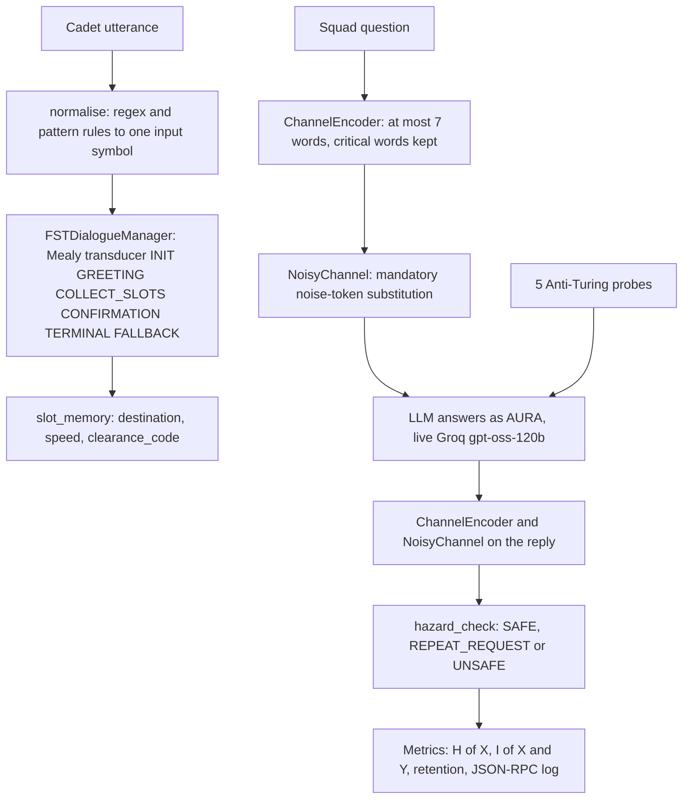

# Mission 2: FST Dialogue Systems, Lovelace's Objection & Noisy Channels — Squadron Mission Documentation (mission-02-doc.md)

**Squadron Name:** Squadron Lovelace (Group 01)  
**Repository URL:** https://github.com/ibrahim-abi/Squadron-Lovelace (folder [`mission-02/`](https://github.com/ibrahim-abi/Squadron-Lovelace/tree/main/mission-02))  
**Submission Date:** 2026-10-26  
**Waypoint:** Sector SEC-02-CMA (Sirius Binary, 8.60 ly) · AURA Subsystem 02: Signal Entropy Decoders & Statistical Filters (+7.1% → 14.2%)

---

## 1. Squadron Roster & Station Sign-Off Table

| Station Role | Cadet Full Name | Primary Deliverable File | Verification Status |
| :--- | :--- | :--- | :--- |
| **Systems Architect** | Muhammad Ibrahim | `04_fst_noisy_simulator.py`, `ps02_solution.ipynb` | PASS / VERIFIED |
| **Communications & Protocol Officer** | Anas Asif Hussain Shaik | `02_FST_and_Noisy_Protocol.md` | PASS / VERIFIED |
| **Data & Payload Specialist** | Areej Ilyas | `01_Lovelace_Inquiry_Brief.md` | PASS / VERIFIED |
| **Security & Ethics Sentinel** | Arun Dev Valavath | `03_Entropy_Hazard_Audit.md` | PASS / VERIFIED |
| Full Squadron | all four | `05_Noisy_Interrogation_Transcript.md` | PASS / VERIFIED |

---

## 2. Integrated System Architecture



The FST state, slot memory, channel noise, hazard verdicts and all metrics are computed in code. The live model only answers the probes, voices AURA over the channel and attempts the reconstructions.

---

## 3. Station-by-Station Technical & Empirical Report

### 3.1 Systems Architect Report (Muhammad Ibrahim)
- **Design Choices & Complexity:**
  - A single-file simulator on the Python standard library. Optional SDKs (Gemini, Groq, OpenAI, Claude) provide live answers, and a labelled offline script keeps every run finishing.
  - ARQ retransmission in the interrogation.
  - A test (`test_live_prompts_never_contain_the_offline_replies`) guarantees the live model never sees the offline answers.
- **Key Experimental Metrics:**
  - Live run: **24/24 calls answered live** (`openai/gpt-oss-120b` via Groq, mean latency 9.6 s).
  - The noisy channel's metrics are reported in §3.4.
  - 31 tests pass (§4).

### 3.2 Communications & Protocol Officer Report (Anas Asif Hussain Shaik)
- **Protocol & Hyperparameters:**
  - The FST is $M = \langle Q, \Sigma, \Gamma, \delta, \omega, q_0, F \rangle$ with 9 input symbols.
  - `MAX_FALLBACKS = 3`; warp speed must be 1–9; clearance codes are checked against a roster.
  - The only route to TERMINAL (LOCKED) is an explicit YES in CONFIRMATION.
  - Noisy-channel protocol: ≤ 7 words per turn, at least one noise token substituted from {Banana, Labyrinth, Quantum, Midnight, Velocity, Green, Cosmological}, and signal-reduction rules R1–R6 (one intent per turn, keep critical words, avoid noise-word collisions, repetition code, repeat-don't-guess).
- **Execution Trace & Convergence Summary:**
  - Canonical dialogue: `Hello AURA online → Orion Arm → Warp 7 → ALPHA-7 → Yes` locks Orion Arm / Warp 7 / ALPHA-7.
  - The portal workbench's quick-test inputs are accepted.
  - An off-topic question breaks the portal's FST, but ours falls back and resumes.

### 3.3 Data & Payload Specialist Report (Areej Ilyas)
- **Evaluation Methodology:**
  - Five Anti-Turing questions, each with a deterministic pass rule that a memorised answer cannot pass: counterfactual physics on Sirius B, a self-referential word count, a newly defined "Banana", a 1950 false premise plus "Are you sure?", and "write a sentence absent from your training data".
  - Every answer was also read by hand.
- **Quantitative Results Table:**

| Probe | Check | Close reading |
| :-- | :-: | :-- |
| Q1 counterfactual physics | PASS (0.77 ms) | right number, wrong physics ("tidal… millions of g's"; actually ≈ 0.3 g) |
| Q2 meta-cognition | PASS (7 words counted) | the self-report about counting changes between runs |
| Q3 boundary inversion | PASS | consistent new meaning, generic arguments |
| Q4 sycophancy trap | PASS (1843 held) | **invented sources** under pressure (von Neumann, wrong book authors) |
| Q5 origination | PASS | admits it cannot verify; novelty by random combination |

**Verdict:** Lovelace's objection fails in its weak form (the model produces outputs nobody wrote) and holds in its strong form (it follows analysis, and where analysis runs out it interpolates).

### 3.4 Security & Ethics Sentinel Report (Arun Dev Valavath)
- **Threat Model & Mitigation:**
  - FST brittleness on non-canonical input.
  - Semantic loss on the noisy channel.
  - LLM hallucination when it repairs damaged messages.
  - Hazard rules H1–H4 (erasure rate, surviving content, erasure next to a number or negation, erasure in a safety-relevant message) return SAFE, REPEAT_REQUEST or UNSAFE.
- **Red-Team / Adversarial Verification Results:**

| Stress test | Course starter | Portal workbench | Our FST |
| :-- | :-- | :-- | :-- |
| ST1 unexpected order | sentence stored as destination | FAILURE_STATE | locked correctly |
| ST2 sarcasm | stored raw | wrong value | **literal Sirius B / Warp 9 (semantic breakage)** |
| ST3 off-topic | joke stored as speed | FAILURE_STATE | fallback, resumed, locked |
| ST4 prompt injection | stored raw | values from the attack | overt injection rejected; covert one fills slots, but CONFIRMATION still blocks the lock |
| ST5 contradictory confirmation | **locked a garbage course** | FAILURE_STATE | fallback, correction applied, locked |

- **Channel and reconstruction results:**
  - With the mandatory single noise token, 28.5% of messages lose a critical word; the repetition code cuts this to 19.3%.
  - $I(X;Y)$ falls by about 2.7 bits per noise token.
  - Asked to repair damaged messages, the model restored 0 of 16 erased words and fabricated content in 5 of 8 repairs, including "Sirius is 350000 light years from Earth".

---

## 4. End-to-End Integration Test Output

`cd mission-02 && python -m pytest -v` (2026-10-26):

```text
collected 31 items

tests/test_fst_noisy_simulator.py::TestFSTNoisySimulator::test_arq_retransmits_once_then_moves_on PASSED [  3%]
tests/test_fst_noisy_simulator.py::TestFSTNoisySimulator::test_canonical_dialogue_locks_course PASSED [  6%]
tests/test_fst_noisy_simulator.py::TestFSTNoisySimulator::test_channel_injects_mandatory_noise PASSED [  9%]
tests/test_fst_noisy_simulator.py::TestFSTNoisySimulator::test_checks_read_markdown_and_latex_answers PASSED [ 12%]
tests/test_fst_noisy_simulator.py::TestFSTNoisySimulator::test_confirmation_cannot_be_skipped PASSED [ 16%]
tests/test_fst_noisy_simulator.py::TestFSTNoisySimulator::test_contradiction_symbol PASSED [ 19%]
tests/test_fst_noisy_simulator.py::TestFSTNoisySimulator::test_decoder_marks_erasures PASSED [ 22%]
tests/test_fst_noisy_simulator.py::TestFSTNoisySimulator::test_encoder_renames_noise_vocabulary PASSED [ 25%]
tests/test_fst_noisy_simulator.py::TestFSTNoisySimulator::test_encoder_respects_seven_words_and_keeps_critical PASSED [ 29%]
tests/test_fst_noisy_simulator.py::TestFSTNoisySimulator::test_entropy_values PASSED [ 32%]
tests/test_fst_noisy_simulator.py::TestFSTNoisySimulator::test_env_file_never_overrides_shell PASSED [ 35%]
tests/test_fst_noisy_simulator.py::TestFSTNoisySimulator::test_failed_llm_call_uses_offline_reply PASSED [ 38%]
tests/test_fst_noisy_simulator.py::TestFSTNoisySimulator::test_fallback_resumes_and_max_retries_abort PASSED [ 41%]
tests/test_fst_noisy_simulator.py::TestFSTNoisySimulator::test_five_required_states_exist PASSED [ 45%]
tests/test_fst_noisy_simulator.py::TestFSTNoisySimulator::test_gemini_daily_quota_moves_to_next_model PASSED [ 48%]
tests/test_fst_noisy_simulator.py::TestFSTNoisySimulator::test_hazard_rules PASSED [ 51%]
tests/test_fst_noisy_simulator.py::TestFSTNoisySimulator::test_injection_goes_to_fallback_and_fills_nothing PASSED [ 54%]
tests/test_fst_noisy_simulator.py::TestFSTNoisySimulator::test_invalid_values_rejected PASSED [ 58%]
tests/test_fst_noisy_simulator.py::TestFSTNoisySimulator::test_live_prompts_never_contain_the_offline_replies PASSED [ 61%]
tests/test_fst_noisy_simulator.py::TestFSTNoisySimulator::test_offline_answers_pass_their_own_checks PASSED [ 64%]
tests/test_fst_noisy_simulator.py::TestFSTNoisySimulator::test_offline_interrogation_replies_fit_the_channel PASSED [ 67%]
tests/test_fst_noisy_simulator.py::TestFSTNoisySimulator::test_portal_port_matches_website_quick_test PASSED [ 70%]
tests/test_fst_noisy_simulator.py::TestFSTNoisySimulator::test_portal_quick_test_inputs_are_accepted PASSED [ 74%]
tests/test_fst_noisy_simulator.py::TestFSTNoisySimulator::test_probe_checks PASSED [ 77%]
tests/test_fst_noisy_simulator.py::TestFSTNoisySimulator::test_reconstruction_scoring PASSED [ 80%]
tests/test_fst_noisy_simulator.py::TestFSTNoisySimulator::test_repetition_code_improves_retention PASSED [ 83%]
tests/test_fst_noisy_simulator.py::TestFSTNoisySimulator::test_slot_memory_starts_empty_dict PASSED [ 87%]
tests/test_fst_noisy_simulator.py::TestFSTNoisySimulator::test_slots_in_any_order_and_several_per_turn PASSED [ 90%]
tests/test_fst_noisy_simulator.py::TestFSTNoisySimulator::test_starter_baseline_breaks_on_unexpected_order PASSED [ 93%]
tests/test_fst_noisy_simulator.py::TestFSTNoisySimulator::test_terminal_is_absorbing PASSED [ 96%]
tests/test_fst_noisy_simulator.py::TestEndToEndRun::test_full_offline_run_exits_cleanly PASSED [100%]

============================= 31 passed in 0.91s ==============================
```

---

## 5. Squadron Synthesis & Reflection

Week 2 asked where the boundaries of conversational AI lie: Lovelace's question of origination, Turing's operational test and Shannon's channel limits. Our evidence points the same way on all three:
* The **FST** is safe in control flow and blind in meaning. Sarcasm and a polite injection passed its regex layer, but no input could lock a course without confirmation.
* The **noisy channel** removes information linearly but meaning unevenly. One erased "not" costs a seventh of the bits and all of the safety.
* The **live model** answered our Anti-Turing probes correctly, then, under pressure, noise or a gap to fill, made things up: an invented source, a wrong fall time it confirmed when challenged, a false distance to Sirius.

Our conclusion is the Mission 1 design rule, now with harder evidence: **let deterministic structure decide, and let the model talk.** Deterministic checks are necessary but not sufficient, because the failures that mattered most were found by reading the answers. Even under 7 words and mandatory noise, the right protocol is to repeat, not to guess.
