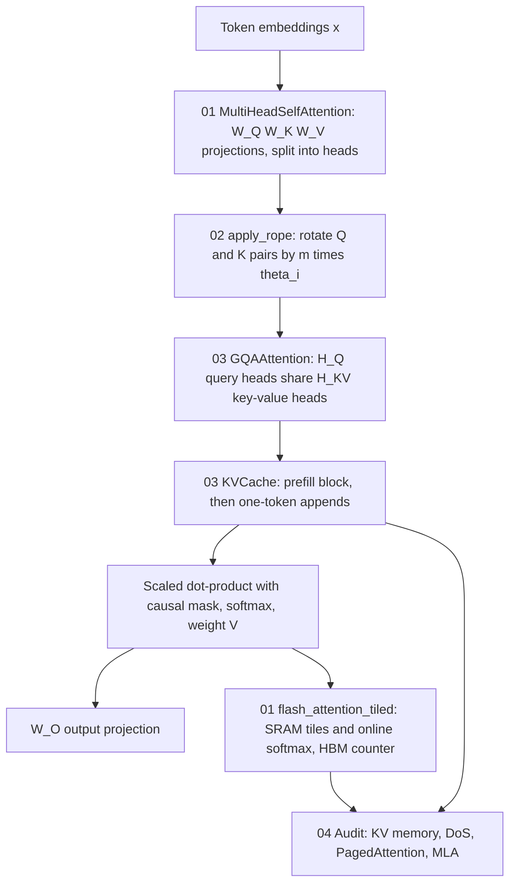

# Mission 3: Multi-Head Attention, RoPE Vector Rotation & Grouped-Query KV-Cache Optimization — Squadron Mission Documentation (mission-03-doc.md)

**Squadron Name:** Squadron Lovelace (Group 01)  
**Repository URL:** https://github.com/ibrahim-abi/Squadron-Lovelace (folder [`mission-03/`](https://github.com/ibrahim-abi/Squadron-Lovelace/tree/main/mission-03))  
**Submission Date:** 2026-10-26  
**Waypoint:** Sector SEC-03-M45 (Pleiades Open Cluster, 444 ly) · AURA Subsystem 03: Distributed Multi-Head Attention Mesh & KV-Cache Transceiver (+7.1% → 21.3%)

---

## 1. Squadron Roster & Station Sign-Off Table

| Station Role | Cadet Full Name | Primary Deliverable File | Verification Status |
| :--- | :--- | :--- | :--- |
| **Systems Architect** | Muhammad Ibrahim | `01_MultiHead_Attention_Core.py` | PASS / VERIFIED |
| **Communications & Protocol Officer** | Anas Asif Hussain Shaik | `02_RoPE_Positional_Engine.py` | PASS / VERIFIED |
| **Data & Payload Specialist** | Areej Ilyas | `03_GQA_and_KVCache_Benchmark.py` | PASS / VERIFIED |
| **Security & Ethics Sentinel** | Arun Dev Valavath | `04_Memory_Hierarchy_and_Safety_Audit.md` | PASS / VERIFIED |
| Full Squadron | all four | `ps03_solution.ipynb` | PASS / VERIFIED |

---

## 2. Integrated System Architecture



The decoder block is assembled from the four station modules. Part 1 supplies the attention core. Part 2 injects position into Q and K. Part 3 shrinks and caches K and V for decoding. Part 4 audits the memory that this pipeline consumes, using numbers measured by Parts 1 and 3.

---

## 3. Station-by-Station Technical & Empirical Report

### 3.1 Systems Architect Report (Muhammad Ibrahim)
- **Design Choices & Complexity:**
  - `MultiHeadSelfAttention` is built from raw `nn.Parameter` matrices $W_Q, W_K, W_V, W_O \in \mathbb{R}^{d \times d}$ and its own softmax. It uses no `nn.MultiheadAttention` or fused kernel, and a test checks the source.
  - Heads are reshaped `(b, N, h, d_k) → (b, h, N, d_k)`.
  - The causal mask puts −∞ above the diagonal. Cost is $O(N^2 d)$ time and $O(N^2)$ memory per head.
- **Key Experimental Metrics:**

| Check | Result |
| :-- | :-- |
| Match with PyTorch fused SDPA | max difference 9.5e-7 |
| Weight on future tokens | exactly 0; changing tokens 10–15 changes outputs 0–9 by 0.0 |
| Var(q·k), $d_k = 64$ | 64.08 → **1.0013** after $/\sqrt{d_k}$ |
| Softmax saturation | 77% of the weight on one key without scaling, 7% with scaling |
| Tiled (FlashAttention-style) attention | exact to 1.8e-7, **3.6–3.9× less HBM traffic** (N = 512–4096, d = 64, 128-row tiles) |

### 3.2 Communications & Protocol Officer Report (Anas Asif Hussain Shaik)
- **Protocol / Selection Math & Hyperparameters:**
  - $\theta_i = \text{base}^{-2(i-1)/d}$ with base 10,000 and d = 128 (periods from 6.3 to 54,410 tokens).
  - `apply_rope(x, freqs_cis)` performs a complex 2-D rotation of each coordinate pair.
  - Proof of invariance: $\langle R_m q, R_n k \rangle = \mathrm{Re}\sum_i q_i \bar k_i e^{j(m-n)\theta_i}$.
- **Execution Trace & Convergence Summary:**

| Check | Result |
| :-- | :-- |
| Equals the block-diagonal $R^d_{\Theta,m}$ | max difference 1.5e-7; norms preserved to 1.9e-6 |
| Relative invariance, 1,000 random $(q,k,m,n,\delta)$ | max \|difference\| 4.0e-6 (float32, positions up to 16,384) |
| RoPE vs ALiBi decay | RoPE decays with oscillation (score 1.0 → 0.32 at 256 tokens, d = 128); ALiBi is a linear penalty. Plots are in `figures/` |
| Extrapolation (trained on 4,096) | plain RoPE: 28.1% of pairs at unseen angles at 8K–32K; Position Interpolation: 0%; NTK base: 26.6% |

### 3.3 Data & Payload Specialist Report (Areej Ilyas)
- **Evaluation Methodology:**
  - LLaMA-3-8B shape: 32 layers, $H_Q = 32$, $d_{head} = 128$, FP16, batch 1.
  - KV memory = $2 \cdot 2 \cdot L \cdot H_{KV} \cdot d \cdot N$ bytes. Bandwidth = cache × 50 tokens/s.
  - Latency was measured on an RTX 3070 (one layer × 32), with a bandwidth lower bound for comparison.
  - Incremental decoding equals the full causal pass (3e-7).
- **Quantitative Results Table:**

| N | Variant | KV-cache MB | GB/s at 50 tok/s | ms/token (measured) | ms/token with `repeat_interleave` |
| --: | :-- | --: | --: | --: | --: |
| 1,024 | MHA / GQA 4:1 / MQA | 512 / 128 / 16 | 25.0 / 6.2 / 0.8 | 14.76 / 9.13 / 8.97 | 18.63 / 11.90 / 10.12 |
| 4,096 | MHA / GQA 4:1 / MQA | 2,048 / 512 / 64 | 100 / 25 / 3.1 | 17.79 / 10.34 / 8.96 | 29.73 / 21.73 / 21.21 |
| 16,384 | MHA / GQA 4:1 / MQA | 8,192 / 2,048 / 256 | 400 / 100 / 12.5 | 34.74 / 16.94 / 8.70 | 80.43 / 75.27 / 78.44 |
| 32,768 | MHA / GQA 4:1 / MQA | 16,384 / 4,096 / 512 | **800** / 200 / 25 | 56.45 / 29.50 / 17.23 | 154.00 / 153.42 / 144.23 |

**Finding.** GQA is 1.9× faster than MHA at 32K, but only when the KV heads are broadcast **without copying**. With `repeat_interleave` it is no faster than MHA. The course portal's KV-cache lab reproduces all 12 memory and bandwidth values exactly (screenshots in `figures/portal/`).

### 3.4 Security & Ethics Sentinel Report (Arun Dev Valavath)
- **Threat Model & Anomaly Mitigation:**
  - The KV-cache is linear in the attacker-controlled context length and is held for the whole session.
  - Concurrent long sessions exhaust GPU memory, and a CUDA OOM aborts the whole batch.
  - FlashAttention IO: standard attention needs $4Nd + 4N^2$ HBM accesses; FlashAttention needs $2Nd + 2N^2 d / B_r = \Theta(Nd + N^2 d^2/M)$. "O(N)" holds for the extra memory, not the traffic.
- **Red-Team / Adversarial Verification Results:**

| Scenario | Result |
| :-- | :-- |
| 80 GB mainframe, 64 GB free, sessions of 65,536 tokens | OOM after **2** (MHA), **8** (GQA), 64 (MQA), 28 (MLA) sessions |
| Live on the RTX 3070 (GQA, 2,048-token sessions) | 27 sessions filled the card as predicted; Windows then **silently spilled 15.5 GB into system RAM**, and the OOM came only at 22.3 GB. The service degraded instead of failing loudly |
| PagedAttention vs contiguous reservation (64 GB, max 32K) | 288 vs 16 requests admitted; waste 0.4% vs 93.6% |
| MLA (DeepSeek-V3) | 36 KiB per token, 7% of MHA's 512 KiB |

**Mitigation:** defence in depth.
* Architecture: GQA now, MLA next.
* Serving: paged allocation with preemption instead of abort.
* Admission control: on projected KV bytes, with per-tenant quotas and context caps.
* Session lifecycle: idle-session reclamation.
* Monitoring: KV blocks per tenant.

---

## 4. End-to-End Integration Test Output

`cd mission-03 && python -m pytest -v` (PyTorch 2.11 + CUDA 12.8, RTX 3070, 2026-10-26):

```text
collected 26 items

tests/test_ps03.py::test_projection_and_head_shapes PASSED               [  3%]
tests/test_ps03.py::test_no_high_level_attention_wrappers_in_the_module PASSED [  7%]
tests/test_ps03.py::test_causal_mask_blocks_the_future PASSED            [ 11%]
tests/test_ps03.py::test_matches_pytorch_reference PASSED                [ 15%]
tests/test_ps03.py::test_padding_mask PASSED                             [ 19%]
tests/test_ps03.py::test_variance_preservation[16] PASSED                [ 23%]
tests/test_ps03.py::test_variance_preservation[64] PASSED                [ 26%]
tests/test_ps03.py::test_variance_preservation[128] PASSED               [ 30%]
tests/test_ps03.py::test_tiled_flash_attention_is_exact_and_counts_io[False] PASSED [ 34%]
tests/test_ps03.py::test_tiled_flash_attention_is_exact_and_counts_io[True] PASSED [ 38%]
tests/test_ps03.py::test_frequency_formula PASSED                        [ 42%]
tests/test_ps03.py::test_apply_rope_is_the_rotation_matrix_and_preserves_norm PASSED [ 46%]
tests/test_ps03.py::test_relative_invariance PASSED                      [ 50%]
tests/test_ps03.py::test_score_depends_only_on_offset PASSED             [ 53%]
tests/test_ps03.py::test_apply_rope_validates_shapes PASSED              [ 57%]
tests/test_ps03.py::test_decay_and_alibi PASSED                          [ 61%]
tests/test_ps03.py::test_extrapolation_metrics PASSED                    [ 65%]
tests/test_ps03.py::test_figures_are_written PASSED                      [ 69%]
tests/test_ps03.py::test_gqa_grouping_shapes PASSED                      [ 73%]
tests/test_ps03.py::test_gqa_with_all_kv_heads_equals_mha PASSED         [ 76%]
tests/test_ps03.py::test_incremental_decoding_equals_full_pass PASSED    [ 80%]
tests/test_ps03.py::test_kv_cache_appends_and_overflows PASSED           [ 84%]
tests/test_ps03.py::test_memory_and_bandwidth_formulas PASSED            [ 88%]
tests/test_ps03.py::test_security_simulations PASSED                     [ 92%]
tests/test_ps03.py::test_scripts_run[mha_core] PASSED                    [ 96%]
tests/test_ps03.py::test_scripts_run[rope_engine] PASSED                 [100%]

============================= 26 passed in 10.67s =============================
```

---

## 5. Squadron Synthesis & Reflection

Week 3 asked how attention computes all token relationships in parallel, and how RoPE, GQA and FlashAttention overcome its $O(N^2)$ bottlenecks.
* Rebuilding the pipeline from first principles showed that the **mathematics is simple and exact**: our attention matches PyTorch's to 1e-6, the $1/\sqrt{d_k}$ scaling restores unit variance, and RoPE's relative invariance holds to float precision.
* The **cost lives in memory, not arithmetic.** The KV-cache grows linearly with context, decoding is bandwidth-bound, and at 32K tokens one MHA session would need more bandwidth than our GPU has.

Our sharpest lessons were about the gap between a formula and a system:
* GQA's 4× memory saving became a speed saving only after we removed a single tensor copy (`repeat_interleave`). The same mathematics ran 5× faster.
* FlashAttention's celebrated "O(N)" turned out, when measured, to describe memory rather than traffic.
* Our out-of-memory test did not fail where theory said it would. The driver silently traded VRAM for system RAM, which is a more dangerous failure for a service than a crash.

Hardware-aware engineering, IO accounting and memory budgets are as much a part of conversational AI as the attention equation itself.
