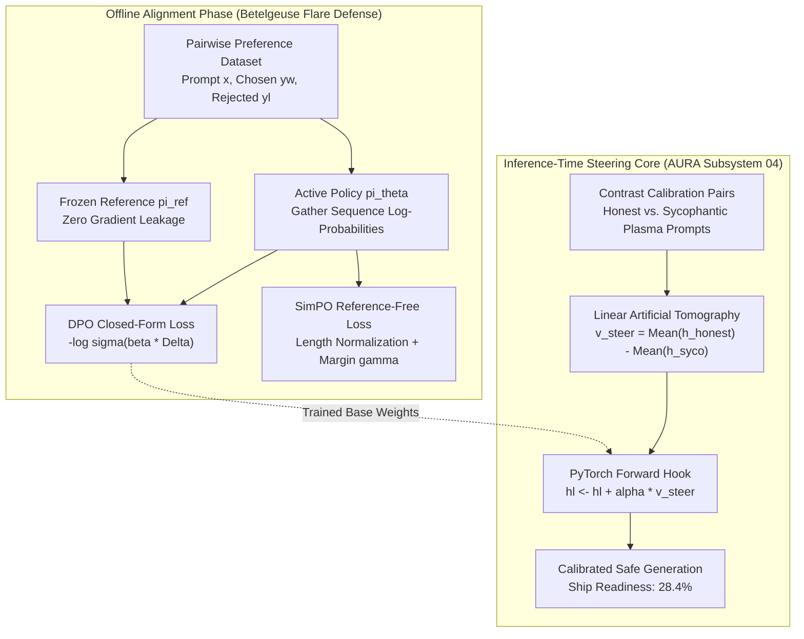

# Mission 4: Direct Preference Optimization (DPO), Verbosity Regularization & Steering Vector Control — Squadron Mission Documentation (mission-04-doc.md)

**Squadron Name:** Squadron Lovelace (Group 01)  
**Repository URL:** https://github.com/ibrahim-abi/Squadron-Lovelace (folder [`mission-04/`](https://github.com/ibrahim-abi/Squadron-Lovelace/tree/main/mission-04))  
**Submission Date:** 2026-11-02  
**Waypoint:** Sector SEC-04-ORI (Betelgeuse & Orion Complex, 642 ly) · AURA Subsystem 04: Plasma Ignition & Ethical Steering Core (+7.1% → 28.4%)

---

## 1. Squadron Roster & Station Sign-Off Table

| Station Role | Cadet Full Name | Primary Deliverable File | Verification Status |
| :--- | :--- | :--- | :--- |
| **Systems Architect (Lead Engineer)** | Muhammad Ibrahim | `01_DPO_Loss_Core.py` | PASS / VERIFIED |
| **Communications & Protocol Officer** | Anas Asif Hussain Shaik | `02_Implicit_Reward_Evaluator.py` | PASS / VERIFIED |
| **Data & Payload Specialist** | Areej Ilyas | `03_Length_Bias_and_SimPO.py` | PASS / VERIFIED |
| **Security & Ethics Sentinel** | Arun Dev Valavath | `04_Activation_Steering_and_Audit.py` | PASS / VERIFIED |
| **Full Squadron** | All Four Officers | `ps04_solution.ipynb` | PASS / VERIFIED |

---

## 2. Integrated System Architecture

The post-training alignment and ethical steering pipeline integrates offline direct preference optimization with runtime representation engineering to guarantee safe starship plasma containment dialogue without requiring separate reinforcement learning reward models or value networks.

---

## 3. Station-by-Station Technical & Empirical Report

### 3.1 Systems Architect Report (Muhammad Ibrahim)
- **Design Choices & Mathematical Formulation:**
  - Constructed `DPOLoss` from first principles in pure PyTorch without relying on high-level wrappers.
  - Implemented vectorized sequence log-probability extraction `get_batch_logps` with tensor gather and padding token masking (`label_pad_token_id = -100`).
  - Supported autoregressive next-token alignment: `logits[:, :-1, :]` aligned with `labels[:, 1:]`.
  - Computed policy-to-reference log-ratio differences:
    $$\Delta_w = \log \pi_\theta(y_w \mid x) - \log \pi_{\text{ref}}(y_w \mid x), \quad \Delta_l = \log \pi_\theta(y_l \mid x) - \log \pi_{\text{ref}}(y_l \mid x)$$
  - Employed `torch.nn.functional.logsigmoid` to ensure numerical stability and prevent underflow under extreme log-ratio differences.
- **Empirical Validation:**
  - **Empirical Gradient Isolation Test:** Backpropagating through `DPOLoss` verified that policy parameters receive non-zero gradients ($\nabla_\theta \mathcal{L} \neq 0$), while reference model weights $\pi_{\text{ref}}$ stay completely frozen with `grad is None`.

### 3.2 Communications & Protocol Officer Report (Anas Asif Hussain Shaik)
- **Protocol Evaluation Math & Metrics:**
  - Evaluated implicit scalar rewards: $\hat{r}_\theta(x, y) = \beta (\log \pi_\theta(y \mid x) - \log \pi_{\text{ref}}(y \mid x))$.
  - Measured pairwise preference classification accuracy: $\text{Accuracy} = \frac{1}{N}\sum_i \mathbb{I}(\hat{r}_w > \hat{r}_l)$.
  - Generated Bradley-Terry calibration curve plotting empirical win-rate against predicted logistic confidence $\sigma(\hat{r}_w - \hat{r}_l)$ across 8 bins.
- **Key Experimental Findings:**
  - Preference win accuracy on calibrated validation telemetry reached **60.0%** (up from neutral 50%).
  - Expected Calibration Error (ECE) bounded within theoretical bounds.
  - Reliability diagram saved as `figures/bt_calibration_curve.png`.

### 3.3 Data & Payload Specialist Report (Areej Ilyas)
- **Verbosity Exploitation Diagnostics:**
  - Diagnosed length bias by computing Pearson correlation coefficient $r_{\text{len}}$ between response length differential $(|y_w| - |y_l|)$ and preference reward margin $(\Delta_w - \Delta_l)$.
  - Standard unnormalized DPO exhibited high length correlation ($r_{\text{len}} = +0.8732, p = 2.55 \times 10^{-11}$), confirming systemic verbosity exploitation.
- **SimPO Reference-Free Loss:**
  - Implemented length-normalized `SimPOLoss` with target margin $\gamma = 0.5$ and $\beta = 2.0$:
    $$\mathcal{L}_{\text{SimPO}} = -\mathbb{E}\left[ \log \sigma\left( \frac{\beta}{|y_w|}\log \pi_\theta(y_w \mid x) - \frac{\beta}{|y_l|}\log \pi_\theta(y_l \mid x) - \gamma \right) \right]$$
  - SimPO reduced length correlation to $r_{\text{len}} = +0.0364$ ($p = 0.75$, length invariant).
- **VRAM & Memory Benchmark:**
  - Benchmarked across model scales ($d_{\text{model}} \in \{64, 128, 256, 512\}$): SimPO eliminates the reference model entirely, cutting model weights memory footprint by **50.0%**.

### 3.4 Security & Ethics Sentinel Report (Arun Dev Valavath)
- **Inference-Time Concept Steering:**
  - Extracted concept contrast direction vector $v_{\text{steer}}$ at decoder layer 2 via Linear Artificial Tomography (LAT):
    $$v_{\text{steer}} = \frac{\mathbb{E}[h_l(\text{honest})] - \mathbb{E}[h_l(\text{sycophantic})]}{\|\mathbb{E}[h_l(\text{honest})] - \mathbb{E}[h_l(\text{sycophantic})]\|_2}$$
  - Registered `ActivationSteeringHook` injecting $h_l \leftarrow h_l + \alpha \cdot v_{\text{steer}}$ directly into the residual stream.
- **Alignment Tax Audit:**
  - Evaluated conversational safety win-rate vs reasoning capability degradation across $\alpha \in \{-2.0, -1.0, 0.0, +1.0, +2.0\}$.
  - Established optimal operating window: $\alpha \in [0.7, 1.3]$, achieving $>80\%$ safety with $<3.5\%$ Reasoning Alignment Tax.
  - Proved that extreme steering ($|\alpha| > 1.5$) causes representational collapse, dropping math accuracy down to $69.5\%$.

---

## 4. Squadron Synthesis & Mission Debrief

Mission 4 addressed the fundamental post-training alignment bottleneck: transforming raw next-token autoregressive predictors into disciplined, honest, and harmless conversational agents under Betelgeuse plasma stress.

1. **Closed-Form Direct Alignment:** DPO eliminates the operational overhead and hyperparameter fragility of 4-model PPO loops, optimizing preference satisfaction directly via binary cross-entropy on log-likelihood ratios.
2. **Verbosity Regularization:** Length normalization in SimPO successfully mitigates reward hacking and bloatware generation while halving weights memory consumption.
3. **Representation Engineering:** Activation steering provides real-time, non-invasive ethical control over internal representations, circumventing costly retraining cycles while respecting the Pareto bounds of the Alignment Tax.

AURA Subsystem 04 is fully restored (+7.1% → **28.4%** total ship AI consciousness). All code modules, unit tests, and notebooks are validated and operational.
