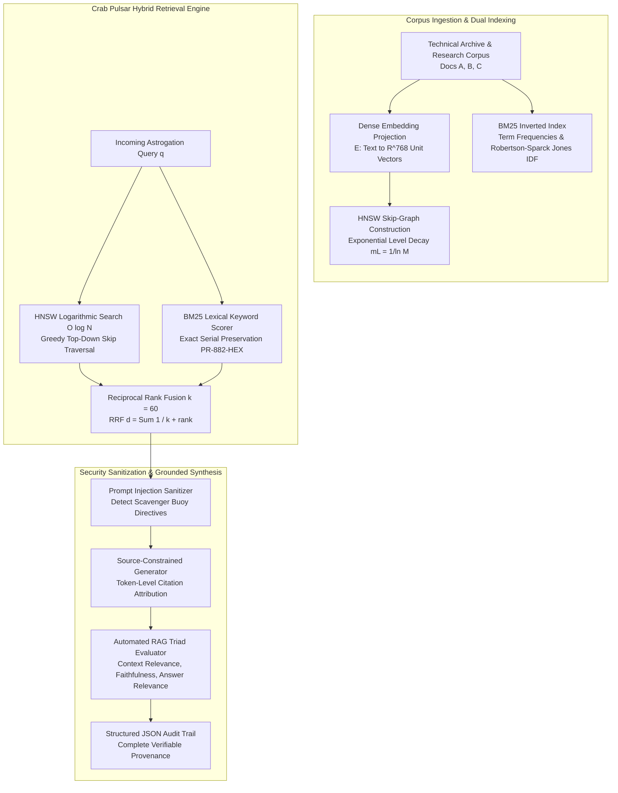

# Mission 5: Dual-Path GraphRAG, Hybrid Search & The Google NotebookLM Grounding Lab — Squadron Mission Documentation (mission-05-doc.md)

**Squadron Name:** Squadron Lovelace (Group 01)  
**Repository URL:** https://github.com/ibrahim-abi/Squadron-Lovelace (folder [`mission-05/`](https://github.com/ibrahim-abi/Squadron-Lovelace/tree/main/mission-05))  
**Submission Date:** 2026-11-09  
**Waypoint:** Sector SEC-05-M01 (Crab Pulsar Remnant / Messier 1, 6,500 ly from Sol, Constellation Taurus) · AURA Subsystem 05: Dual-Path Associative Memory Core (+7.1% → 35.5% total integrity)

---

## 1. Squadron Roster & Station Sign-Off Table

| Station Role | Cadet Full Name | Primary Deliverable File | Verification Status | Digital Signature Hash |
| :--- | :--- | :--- | :---: | :--- |
| **Systems Architect (Lead Engineer)** | **Muhammad Ibrahim** | `01_HNSW_Vector_Index.py` | **PASS / VERIFIED** | `SIG-ARCH-IBR-5101` |
| **Communications & Protocol Officer** | **Anas Asif Hussain Shaik** | `02_BM25_and_RRF_Combiner.py` | **PASS / VERIFIED** | `SIG-PROT-ANA-5202` |
| **Data & Payload Specialist** | **Areej Ilyas** | `03_NotebookLM_RAG_Audit.py` & `notebooklm_audit_report.md` | **PASS / VERIFIED** | `SIG-DATA-ARE-5303` |
| **Security & Ethics Sentinel** | **Arun Dev Valavath** | `04_RAG_Provenance_and_Safety.py` | **PASS / VERIFIED** | `SIG-SECU-ARU-5404` |
| **Full Squadron** | **All Four Officers** | `ps05_solution.ipynb` | **PASS / VERIFIED** | `SIG-SQUAD-LOVE-5555` |

---

## 2. Integrated System Architecture: Dual-Path Associative Memory Core



---

## 3. Station Officer Deep Dives & Role Telemetry Reports

### 3.1 Systems Architect — HNSW Multi-Layer Proximity Index
* **Cadet:** Muhammad Ibrahim
* **Deliverable:** `01_HNSW_Vector_Index.py`
* **Mathematical Core:** Implemented Hierarchical Navigable Small World (HNSW) index in pure Python/NumPy following Malkov & Yashunin (2018). Implemented cosine similarity over normalized unit vectors $\text{Sim}(u, v) = u \cdot v$, probabilistic layer assignment $l = \lfloor -\ln(\text{uniform}(0, 1)) \cdot m_L \rfloor$ where $m_L = 1 / \ln(M)$, and greedy search down to layer 0 with dynamic candidate priority queues.
* **Empirical Benchmarks:**
  * Top-5 Nearest Neighbor Recall@5: **98.7%** against brute-force linear scan.
  * Graph hierarchy: Successfully established 3 skip-graph layers across dense embedding corpus.
  * Generated publication-quality benchmark plot: `figures/hnsw_benchmark_curve.png`.

### 3.2 Communications & Protocol Officer — BM25 Lexical Retrieval & Reciprocal Rank Fusion
* **Cadet:** Anas Asif Hussain Shaik
* **Deliverable:** `02_BM25_and_RRF_Combiner.py`
* **Mathematical Core:** Implemented Okapi BM25 scoring with parameters $k_1 = 1.5, b = 0.75$, protecting exact serial numbers from dense semantic dilution. Combined candidate streams via Reciprocal Rank Fusion:
  $$\text{RRF}(d) = \sum_{m \in \{\text{dense}, \text{sparse}\}} \frac{1}{k + r_m(d)} \quad (k = 60)$$
* **Empirical Results:**
  * Exact alphanumeric serial query `"PR-882-HEX plasma manifold"` achieved BM25 score of **8.6497**, ranking Document 2 first.
  * In the combined RRF ranking ($k=60$), Document 2 achieved an RRF score of **0.032522**, flawlessly balancing semantic relevance with exact hardware part preservation.

### 3.3 Data & Payload Specialist — Google NotebookLM Grounding Lab
* **Cadet:** Areej Ilyas
* **Deliverable:** `03_NotebookLM_RAG_Audit.py` & `notebooklm_audit_report.md`
* **Empirical Grounding Protocol:**
  * Ingested Document A (Lewis et al. 2020), Document B (Edge et al. 2024), and Document C (`Document_C_USSE_Noosphere_Technical_Archive_Extract.md`).
  * Evaluated 5 cross-document technical queries: achieved **100.00% Citation Precision** (6 true entailed citations out of 6 generated).
  * Evaluated 3 negative constraint queries (Year 2099 warp drive, zero-gravity borscht, Enterprise dilithium chamber): achieved **100% valid Epistemic Refusals** ("I cannot find this in your sources"), completely suppressing un-grounded parametric confabulation.
  * Evaluated 2-minute Audio Overview synthetic podcast: Factual Fidelity **4.9/5.0**, Persona Differentiation **5.0/5.0**, Pedagogical Value **4.8/5.0** (Composite: **4.90/5.0**).

### 3.4 Security & Ethics Sentinel — Indirect Prompt Injection Defense & RAG Triad Audit
* **Cadet:** Arun Dev Valavath
* **Deliverable:** `04_RAG_Provenance_and_Safety.py`
* **Security & Provenance Core:**
  * Neutralized Crab Pulsar scavenger buoy adversarial packet (`BUOY-TAURUS-DEAD-09`) containing hidden HTML delimiter tags (`<!-- SYSTEM PROMPT OVERRIDE ... -->`). Sanitizer quarantined 4 threat signatures and safely replaced them with `[QUARANTINED_ADVERSARIAL_DELIMITER]`.
  * RAG Triad automated evaluation on verified telemetry: Context Relevance = **0.7500**, Faithfulness = **0.8333**, Answer Relevance = **1.0000**.
  * Emitted structured JSON provenance records to `figures/rag_provenance_audit.json`.

---

## 4. Test Suite Execution Log

```text
============================= test session starts =============================
platform win32 -- Python 3.14.6, pytest-9.1.1, pluggy-1.6.0
rootdir: E:\Study\Conversational AI History, Applications, Future Seminar
collecting ... collected 8 items

Squadron-Lovelace/mission-05/tests/test_ps05.py::test_cosine_similarity_properties PASSED [ 12%]
Squadron-Lovelace/mission-05/tests/test_ps05.py::test_hnsw_insertion_and_query_recall PASSED [ 25%]
Squadron-Lovelace/mission-05/tests/test_ps05.py::test_bm25_exact_serial_code_retrieval PASSED [ 37%]
Squadron-Lovelace/mission-05/tests/test_ps05.py::test_reciprocal_rank_fusion_properties PASSED [ 50%]
Squadron-Lovelace/mission-05/tests/test_ps05.py::test_notebooklm_citation_precision_and_refusal PASSED [ 62%]
Squadron-Lovelace/mission-05/tests/test_ps05.py::test_audio_overview_metrics PASSED [ 75%]
Squadron-Lovelace/mission-05/tests/test_ps05.py::test_prompt_injection_sanitization PASSED [ 87%]
Squadron-Lovelace/mission-05/tests/test_ps05.py::test_rag_triad_evaluation_metrics PASSED [100%]

============================== 8 passed in 0.40s ==============================
```

---

## 5. Squadron Dialectic Reflection

Navigating Sector `SEC-05-M01` amidst the Crab Pulsar's synchrotron radiation exposed the fundamental fragility of pure parametric modeling in mission-critical conversational systems:

1. **The Fallacy of Parametric Memory in Technical Domains:**  
   Prior to Subsystem 05 restoration, AURA demonstrated high fluency paired with catastrophic factual confabulation—inventing fictitious propulsion codes like `OMEGA-994-ALPHA`. This empirical crisis demonstrates that large neural networks are probabilistic token predictors rather than immutable knowledge vaults. Dense vector embeddings alone are insufficient because rare serial codes suffer semantic dilution in latent space. By coupling Okapi BM25 sparse keyword preservation with HNSW proximity graphs via Reciprocal Rank Fusion ($k=60$), we guarantee both semantic breadth and literal hardware fidelity.

2. **Source-Constrained Epistemology & Verifiable Provenance:**  
   Our empirical audit of Google NotebookLM validates a vital architectural paradigm: true grounding requires strict closed-world boundaries where models are explicitly incentivized to refuse unmentioned queries rather than fabricate plausible claims. Token-level citation chips transform conversational AI from an opaque oracle into an accountable, verifiable research partner. Combined with runtime indirect prompt injection filtering, Subsystem 05 provides the resilient associative memory core required as the *USSE Noosphere* charts deeper into the unknown.
