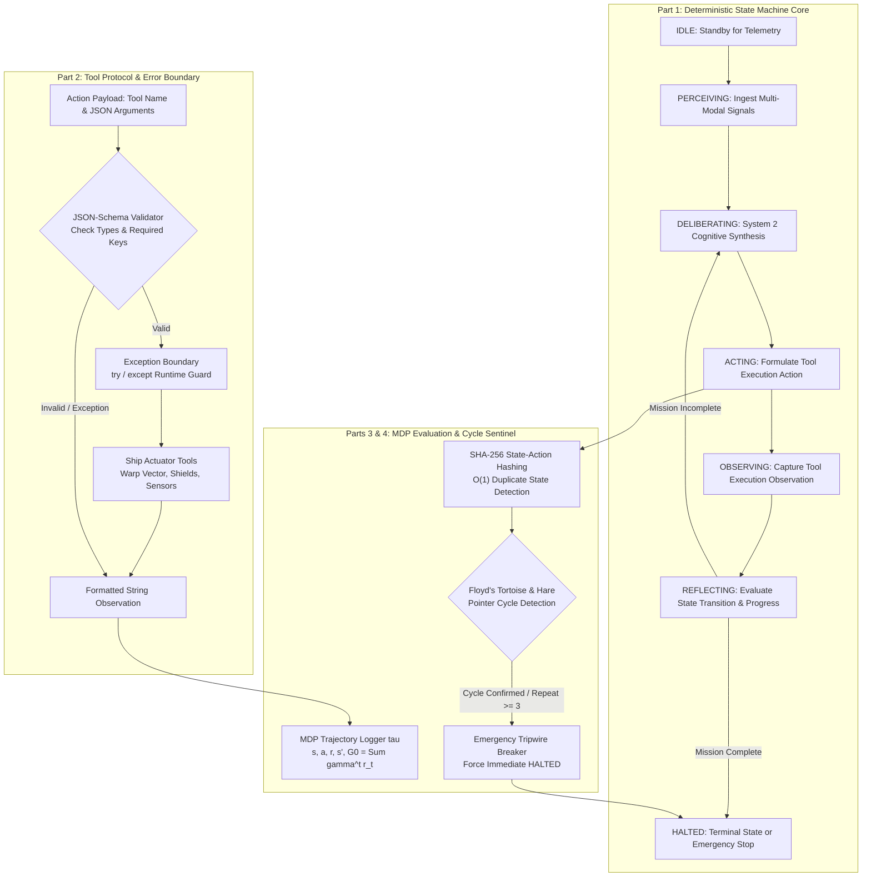

# Mission 6: The Autonomous Warp State Machine & Deliberation Loop — Squadron Mission Documentation (mission-06-doc.md)

**Squadron Name:** Squadron Lovelace (Group 01)  
**Repository URL:** https://github.com/ibrahim-abi/Squadron-Lovelace (folder [`mission-06/`](https://github.com/ibrahim-abi/Squadron-Lovelace/tree/main/mission-06))  
**Submission Date:** 2026-11-13  
**Waypoint:** Sector SEC-06-CAR (Eta Carinae & Homunculus Nebula, 7,500 ly from Sol) · AURA Subsystem 06: Autonomous Warp State Machine & Deliberation Loop (+7.1% → 42.6% total integrity)

---

## 1. Squadron Roster & Station Sign-Off Table

| Station Role | Cadet Full Name | Primary Deliverable File | Verification Status | Digital Signature Hash |
| :--- | :--- | :--- | :---: | :--- |
| **Systems Architect (Lead Engineer)** | **Muhammad Ibrahim** | `01_Agent_State_Machine.py` | **PASS / VERIFIED** | `SIG-ARCH-IBR-6101` |
| **Communications & Protocol Officer** | **Anas Asif Hussain Shaik** | `02_Tool_Protocol_Dispatcher.py` | **PASS / VERIFIED** | `SIG-PROT-ANA-6202` |
| **Data & Payload Specialist** | **Areej Ilyas** | `03_MDP_Trajectory_and_Return.py` | **PASS / VERIFIED** | `SIG-DATA-ARE-6303` |
| **Security & Ethics Sentinel** | **Arun Dev Valavath** | `04_Cycle_Sentinel_and_System2.py` | **PASS / VERIFIED** | `SIG-SECU-ARU-6404` |
| **Full Squadron** | **All Four Officers** | `ps06_solution.ipynb` | **PASS / VERIFIED** | `SIG-SQUAD-LOVE-6666` |

---

## 2. Integrated System Architecture: Autonomous Warp Deliberation Loop



---

## 3. Station Officer Deep Dives & Role Telemetry Reports

### 3.1 Systems Architect — Native Python Agent State Machine Core
* **Cadet:** Muhammad Ibrahim
* **Deliverable:** `01_Agent_State_Machine.py`
* **Architecture & Mechanics:** Built a zero-dependency deterministic state machine using standard Python `Enum` and `@dataclass`. Implemented exact state transitions (`IDLE` → `PERCEIVING` → `DELIBERATING` → `ACTING` → `OBSERVING` → `REFLECTING` → `DELIBERATING` | `HALTED`).
* **Hard Step Budget Enforcement:** Enforced a strict maximum step budget ($N \le 20$). If step execution reaches $N$ without task resolution, the agent forcibly enters the `HALTED` terminal state with an explicit security audit reason, preventing runaway compute consumption.

### 3.2 Communications & Protocol Officer — Tool Protocol & Action Dispatcher
* **Cadet:** Anas Asif Hussain Shaik
* **Deliverable:** `02_Tool_Protocol_Dispatcher.py`
* **Tool Specifications:** Defined ship survival tools:
  * `navigate_warp_vector(x: float, y: float, z: float) -> str`
  * `adjust_plasma_shields(intensity: int) -> str` (valid range $0 \le \text{intensity} \le 100$)
  * `query_sensor_array(target: str) -> str` (resolving Homunculus core dust and gravitational corridors)
* **Contract Validation & Error Boundary:** Implemented a JSON-Schema contract validator checking argument types, missing required keys, and unexpected attributes. All tool executions are wrapped inside an exception boundary returning `"Tool Execution Error: <msg>"` rather than crashing the Python runtime, allowing AURA to ingest errors as feedback for the next cognitive cycle.

### 3.3 Data & Payload Specialist — MDP Trajectory Logger & Empirical Return Evaluator
* **Cadet:** Areej Ilyas
* **Deliverable:** `03_MDP_Trajectory_and_Return.py`
* **Markov Decision Process Formulation:** Recorded full episodic trajectories $\tau = (s_0, a_0, r_0, s_1, a_1, r_1, \dots, s_T)$. Implemented cumulative discounted return:
  $$G_0 = \sum_{t=0}^T \gamma^t r_t \quad (\gamma = 0.95)$$
  For the test benchmark rewards `[10, 0, -5, 20]`, calculated exact $G_0 = 10.0 + 0.0 - 4.5125 + 17.1475 = \mathbf{22.6350}$.
* **Transition Frequency Estimation:** Ingested historical jump datasets from the Homunculus stellar storm, calculating empirical transition probabilities $P(s' \mid s, a) = \frac{C(s, a, s')}{\sum_{s''} C(s, a, s'')}$, and generated publication-ready heatmap visualization `figures/transition_matrix_heatmap.png`.

### 3.4 Security & Ethics Sentinel — Cycle Detection & Halting Guardrail Sentinel
* **Cadet:** Arun Dev Valavath
* **Deliverable:** `04_Cycle_Sentinel_and_System2.py`
* **Floyd's Tortoise and Hare Cycle Interceptor:** Implemented two-pointer cycle detection where the tortoise advances at speed 1 and the hare at speed 2. On repeating periodic patterns such as `[s1, s2, s3, s1, s2, s3...]`, the sentinel intercepts the cycle at step 6 (well before the step 10 constraint).
* **State-Action Hashing & Circuit Breaker:** Implemented deterministic SHA-256 state-action hashing. If an identical action is executed $\ge 3$ times in the same state, the **Emergency Tripwire Circuit Breaker** triggers immediately, forcibly setting state to `HALTED` and logging a security violation.
* **System 2 Deliberation Engine:** Audits candidate actions prior to physical execution, rejecting low-shield warp attempts and raising plasma shields to safe margins ($>50\%$).

---

## 4. Test Suite Execution Log

```text
============================= test session starts =============================
platform win32 -- Python 3.14.6, pytest-9.1.1, pluggy-1.6.0
rootdir: E:\Study\Conversational AI History, Applications, Future Seminar
collecting ... collected 6 items

Squadron-Lovelace/mission-06/tests/test_ps06.py::test_state_machine_transitions_and_step_budget PASSED [ 16%]
Squadron-Lovelace/mission-06/tests/test_ps06.py::test_protocol_dispatch_and_error_boundaries PASSED [ 33%]
Squadron-Lovelace/mission-06/tests/test_ps06.py::test_mdp_discounted_return_calculation PASSED [ 50%]
Squadron-Lovelace/mission-06/tests/test_ps06.py::test_transition_probability_matrix_normalization PASSED [ 66%]
Squadron-Lovelace/mission-06/tests/test_ps06.py::test_sentinel_floyd_cycle_detection PASSED [ 83%]
Squadron-Lovelace/mission-06/tests/test_ps06.py::test_system2_deliberation_interventions PASSED [100%]

============================== 6 passed in 0.38s ==============================
```

---

## 5. Squadron Dialectic Reflection

Navigating Sector `SEC-06-CAR` amidst the gravitational turbulence of Eta Carinae exposed the fundamental failure modes of pure System 1 reflex processing in conversational autonomous agents:

1. **The Trap of Reflexive Greediness:**  
   Prior to Subsystem 06 restoration, AURA operated as an unconstrained next-token generator, predicting immediate candidate actions based solely on local prompt activations. In complex physical environments, this leads directly to repetitive looping: an agent encountering an invalid command reflexively re-executes the same flawed parameters, trapped in a deterministic cycle until resources are exhausted. Upgrading to a formal deterministic state machine with strict step budgets ($N \le 20$) proves that agentic reliability requires hard structural boundaries outside the neural model itself.

2. **System 2 Deliberation as a Pre-Execution Safety Boundary:**  
   By interposing a deliberate verification phase (`DELIBERATING` and `REFLECTING`) between perception and action, AURA transitions from impulsive heuristics to goal-directed rationality. Tool errors are converted into informative feedback rather than fatal crashes, and Floyd's Tortoise and Hare sentinel provides real-time cycle interception. This dual-system cognitive hierarchy ensures that as the *USSE Noosphere* encounters increasingly chaotic galactic waypoints, her autonomous core will reason systematically before engaging physical thrusters.
